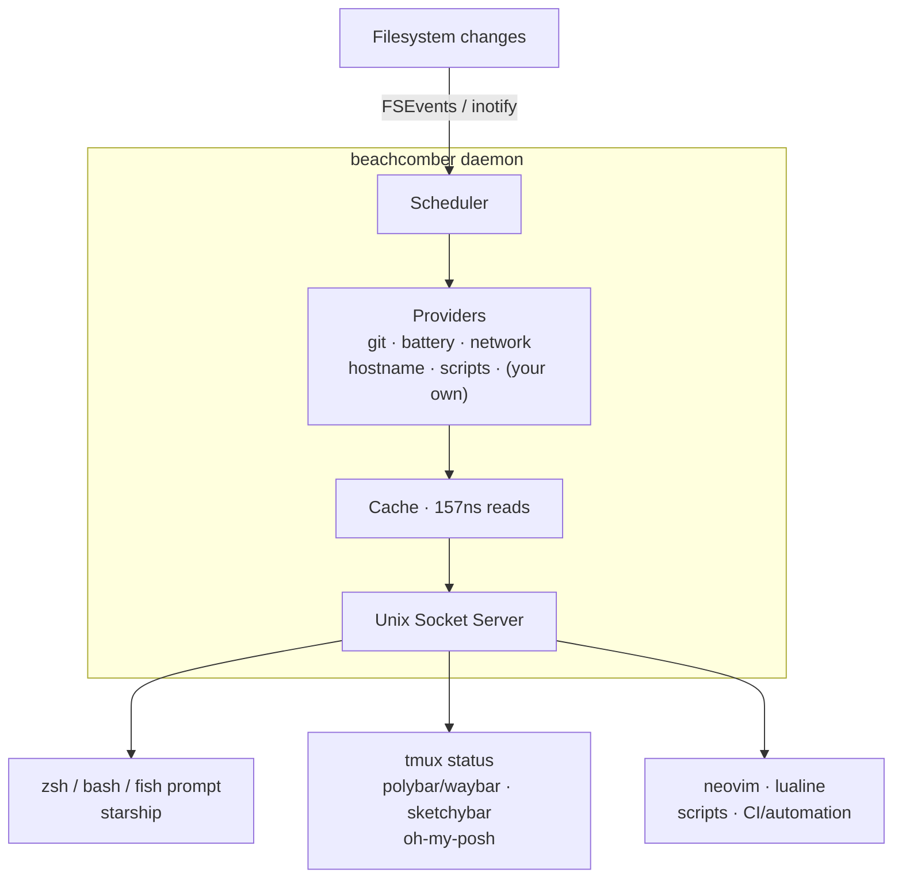

# beachcomber

> One daemon. One cache. Every consumer reads from it.

---

## The Problem

Picture your typical development machine. You have 30 terminal shells open — tmux, iTerm tabs, nested sessions. Each one is running powerlevel10k with gitstatus enabled.

**That's 30 gitstatusd daemons.** Each one spawns a thread pool of up to `min(32, 2 × NUM_CPUS)` threads. On a 16-core machine, that's 960 threads — all independently watching overlapping filesystem trees, all independently computing the same answer to "what branch am I on?"

Now look at your tmux status bar. If you're using a common config like gpakosz/.tmux, it forks a shell process for every pane to collect battery, hostname, and git data. Every 10 seconds. 50 panes × 10 data points = **500 shell forks every 10 seconds.** Your laptop is burning CPU to spawn processes that each run for 5ms and return the same answer they returned 10 seconds ago.

Meanwhile, `fseventsd` is pegging a CPU core dispatching the same filesystem change event to 30 independent FSEvents registrations — one per gitstatusd instance — all watching the same `.git` directory.

Every shell, every editor plugin, every status bar, every prompt framework is independently asking the same questions about the same files with no coordination whatsoever.

**beachcomber** is a single daemon that watches directories, computes shell state, and caches it. Every consumer — prompts, tmux, editors, scripts — reads from the same cache via a Unix socket. One watcher. One computation. Infinite readers.

---

## The Numbers

| Operation | Latency |
|---|---|
| Cache read (global key) | **157 ns** |
| Socket query (warm, persistent connection) | **15 µs** |
| Socket query (cold, new connection) | 34 µs |
| Git status (at parity with raw `git status`) | **5.6 ms** |
| Throughput (10 concurrent clients) | **45,000 req/sec** |

**Real-world impact:**

| Scenario | Without beachcomber | With beachcomber | Improvement |
|---|---|---|---|
| zsh prompt (3 queries) | ~5ms (gitstatus fork) | **45µs** (persistent session) | 111x faster |
| tmux status (100 panes, 10s refresh) | ~2.5s CPU (500 shell forks) | **7.5ms** (socket queries) | 333x fewer forks |
| fseventsd dispatch load | N watchers × N events | 1 watcher, shared | Linear reduction |

---

## Quick Look

```
$ comb g git.branch .          # g = get, text is the default format
main

$ comb g hostname.short
Project2501

$ comb g battery.percent
85

$ comb g.s git .                # .s = shell format: key='value' lines, quoted for eval
ahead='0'
behind='0'
branch='main'
branch_default='main'
branch_parent='main'
commit='36b2704'
commit_summary='init'
conflicted='0'
detached='false'
dirty='true'
…                               # one line per field, sorted — 30 in all

$ comb g git .                   # default: text — the same key=value lines, unquoted
ahead=0
behind=0
branch=main
branch_default=main
branch_parent=main
commit=36b2704
commit_summary=init
conflicted=0
detached=false
dirty=true
…

$ comb g.j git .                 # .j = JSON: the bare value, no envelope (age is in git:cache.branch)
{
  "ahead": 0,
  "behind": 0,
  "branch": "main",
  "branch_default": "main",
  "branch_parent": "main",
  "commit": "36b2704",
  "commit_summary": "init",
  "conflicted": 0,
  "detached": false,
  "dirty": true,
  …
}

$ comb s                         # status: one row per warm cache entry
PROVIDER  PATH    FIELD    VALUE    AGE   TTL
git       /repo   branch   main     14s   ★     60s×12 ◉
git       /repo   dirty    true     14s   ★     60s×12 ◉
battery   -       percent  87       8s    ★     30s×04
hostname  -       short    artemis  3h    ---
```

All commands use single-letter shorthands (`g` get, `s` status, `w` watch, `p` put, `r` refresh, `e` eval, `i` init, `c` check, `d` daemon, `k` kill). Format suffixes (`.s` shell, `.t` tsv, `.T` TSV+header, `.f` template, `.c` csv, `.C` CSV+header, `.j` json) replace the `-f` flag. Text is the default — `comb g` and `comb g git.branch .` both return plain text. Long forms always work too: `comb get git.branch . -f text` is the same as `comb g git.branch .`

---

## Table of Contents

- [Quick Start](#quick-start)
- [How It Works](#how-it-works)
- [CLI Reference](#cli-reference)
- [Configuration Reference](#configuration-reference)
- [Built-in Providers Reference](#built-in-providers-reference)
- [Consumer Integration](#consumer-integration)
- [Shell Fallback & Integration Scripts](#shell-fallback--integration-scripts)
- [Client SDKs](#client-sdks)
- [Custom Providers Guide](#custom-providers-guide)
- [Debugging](#debugging)
- [Protocol Reference](#protocol-reference)
- [Alternatives and Prior Art](#alternatives-and-prior-art)
- [FAQ](#faq)
- [Contributing](#contributing)

---

## Quick Start

### Install

```sh
# Homebrew (macOS)
brew install navistau/tap/beachcomber

# npm
npm install -g beachcomber

# pip
pip install beachcomber

# Cargo (Rust toolchain required)
cargo install beachcomber
```

The npm and pip packages download the correct pre-built binary for your platform from GitHub Releases. You can also use `npx beachcomber`, `uvx beachcomber`, or `uv tool install beachcomber`.

#### Debian/Ubuntu

Download the `.deb` from the [latest release](https://github.com/NavistAu/beachcomber/releases/latest):

```sh
curl -LO https://github.com/NavistAu/beachcomber/releases/latest/download/beachcomber_0.9.1-1_amd64.deb
sudo dpkg -i beachcomber_0.9.1-1_amd64.deb
```

```sh
# ARM64
curl -LO https://github.com/NavistAu/beachcomber/releases/latest/download/beachcomber_0.9.1-1_arm64.deb
sudo dpkg -i beachcomber_0.9.1-1_arm64.deb
```

#### Fedora/RHEL

Download the `.rpm` from the [latest release](https://github.com/NavistAu/beachcomber/releases/latest):

```sh
curl -LO https://github.com/NavistAu/beachcomber/releases/latest/download/beachcomber-0.9.1-1.x86_64.rpm
sudo rpm -i beachcomber-0.9.1-1.x86_64.rpm
```

```sh
# ARM64
curl -LO https://github.com/NavistAu/beachcomber/releases/latest/download/beachcomber-0.9.1-1.aarch64.rpm
sudo rpm -i beachcomber-0.9.1-1.aarch64.rpm
```

#### Arch Linux (AUR)

```sh
# From source
yay -S beachcomber

# Prebuilt binary
yay -S beachcomber-bin
```

#### Nix

```sh
nix run github:NavistAu/beachcomber
```

#### Pre-built binaries

Pre-built binaries are available on the [GitHub Releases](https://github.com/NavistAu/beachcomber/releases) page for the following targets:

- `aarch64-apple-darwin` (macOS, Apple Silicon)
- `x86_64-apple-darwin` (macOS, Intel)
- `x86_64-unknown-linux-gnu` (Linux, glibc)
- `x86_64-unknown-linux-musl` (Linux, musl/static)
- `aarch64-unknown-linux-gnu` (Linux ARM64, glibc)

### Verify

The daemon starts automatically on first use — no setup required.

```sh
# Query your current git branch (run from inside a git repo)
comb g git.branch .

# Query battery
comb g battery.percent

# Check daemon status
comb s
```

That's it. The daemon started in the background when you ran that first query.

### Try it in your prompt

```sh
# Add to ~/.zshrc
precmd() {
    PS1="%F{blue}$(comb g git.branch . 2>/dev/null)%f %# "
}
```

Source your `.zshrc` and open a few more shells. Then run `comb s` — you'll see the cache entry being shared across all shells, with a single filesystem watcher covering all of them.

---

---

## How It Works

beachcomber is a single async daemon that:

1. Serves queries from consumers (prompts, status bars, editors) via a Unix socket
2. Watches filesystem directories using native FSEvents (macOS) or inotify (Linux)
3. Executes providers when files change or poll timers fire — not on every query
4. Caches results in a shared in-memory map (157ns reads)
5. Returns cached data instantly to any number of concurrent readers

The daemon is socket-activated: it starts automatically when any client connects, and shuts down after an idle period when all connections drop.



**Providers are never re-executed on every query.** A git status is computed once when `.git` changes, then served from cache to every reader — whether that's one prompt or a hundred tmux panes. The filesystem watcher is registered once for all concurrent readers.

**The directory you are standing in is the default.** `comb g git.branch` with no path addresses the current working directory; `comb g --global git.branch` addresses the global entry, which is `$HOME`. An SDK session that holds one connection open can set its directory once with the `context` op and leave the path off every request after that.

**Demand-driven lifecycle:** the daemon watches nothing until queried. Each `get` request signals demand, keeping the provider warm automatically. Resource usage scales with actual query patterns. Entries enter a decay sequence after queries stop — staying warm for a grace period (30s default) in case a new shell opens, then progressively slowing and eventually evicting.

**Put and streaming:** external processes can also write data into the cache via `comb p`, exposing arbitrary state to prompt and statusline consumers without writing a Source. Long-lived connections can stream changes via `comb w`, receiving an NDJSON line each time a cache value is updated.

---

## CLI Reference

All commands are subcommands of `comb`. The daemon is socket-activated — you never need to start it manually. All commands have single-letter shorthands and format suffixes — see the Quick Look above for the pattern.

### `comb g` (get) `<key> [path]`

Query a value. Returns cached data immediately. On a cold cache (first query for a key), executes the provider inline and blocks briefly while it runs — subsequent queries return the cached value with no delay. Any node of the tree is addressable at any depth, and a key backed by a template (the managed `defaults/`, a `[client.providers.<p>] template.*` table, or a `comb p <p>:template.<f>`) is rendered here with this shell's environment — `comb g` resolves through `libbeachcomber::resolve`, the same function every SDK's `resolve` calls, and always needs the daemon.

```sh
# Format suffixes on the command control output format
comb g git.branch .            # text: raw value → main (default)
comb g.s git .                  # shell: key=value lines, every value quoted → branch='main'\ndirty='false'\n...
comb g.j git .                   # json: the bare value, nested (metadata is in the :cache facet)
comb g.c git .                   # csv: comma-separated values
comb g.C git .                   # CSV: with header row
comb g.t git .                   # tsv: tab-separated values
comb g.T git .                   # TSV: with header row
comb g.f '{{ branch }} ({{ dirty }})' git .  # template: → main (false)

# Long form always works too (default format is text, so -f is usually unnecessary)
comb get git.branch .            # same as comb g git.branch .

# Multiple keys in one connection (variadic)
comb g git.branch git.dirty battery.percent .

# Force immediate recomputation before returning
comb g --force git .

# Block until a fresh value arrives (useful after a trigger)
comb g --wait git.branch .

# Global providers (no path needed)
comb g battery.percent
comb g hostname.short

# Template-backed keys render here, with this shell's environment (exec() enabled)
comb g python.version .        # defaults/python.toml's cascade over $PYENV_VERSION, mise, asdf, the venv
comb g kubecontext.context     # kubectl config current-context, through exec()
comb g python:template.version # the raw template text, unrendered

# The global entry ($HOME) alone, ignoring the current directory
comb g --global myapp.status

# Field metadata — the :cache facet mirrors the tree
comb g.j git:cache.branch .    # → {"age_ms": 1240, "stale": false, "source": "source(head)", ...}
```

**Exit codes:**
- `0` — success; also a miss under `text`/`sh`, which print nothing
- `2` — a miss under `json`, `csv`, `tsv` or `fmt` (`Error querying <key>: no data (cache miss)` on stderr)
- `2` — error (daemon unreachable, invalid key, a template that does not compile or cycles — named in the message)

### `comb s` (status)

Show all warm cache entries as a table — one row per provider field, with SOURCE naming what produced each value: a Source of the provider (`source(head)`), `put`, `config(<file>)`, `computed(return)`, or `template`. The `TTL` column shows each entry's lifecycle position (`★` active, `3`/`2`/`1`/`0` decay countdown), effective poll interval, Active-window poll count, and whether filesystem events will reinstate the entry (`◉`).

`watch -c comb status` is the recommended live view — it keeps colour and the human preset active even when stdout is a pipe, so you can watch entries pulse through their lifecycle in real time. Each refresh re-renders the caller's template leaves, `exec()` included, so a tight interval multiplies whatever the templates spawn.

```sh
$ comb s
PROVIDER  PATH    FIELD    SOURCE  VALUE    AGE   TTL
git       /repo   branch   head    main     14s   ★     60s×12 ◉
git       /repo   dirty    status  true     14s   ★     60s×12 ◉
hostname  -       short    host    artemis  3h    ---

# Filter to entries in a specific lifecycle state
comb s --filter=lifecycle=active
comb s --filter=lifecycle=decay1
comb s --filter=fsevents_reinstate=true

# Sort options
comb s --sort age             # oldest first
comb s --sort lifecycle       # most-decayed first

# Script-friendly formats (bypass the human preset)
comb s -f tsv
comb s -f json
```

**Flags:** `--format <preset>` (one of: `human`, `tsv`, `json`, `csv`, `table`, `sh`), `--filter <KEY=VALUE>`, `--filter=lifecycle=active|decay<N>|once|static|template`, `--filter=fsevents_reinstate=true|false`, `--sort <default|provider|path|field|value|age|stale|lifecycle>`, `--no-trunc`, `--max-width=auto|N` (default 120), `--color=auto|always|never`, `--ascii`.

A namespace holding a `[client.providers.<p>]` template renders one extra row per leaf visible from the caller's directory — resolved with this shell's environment and `exec()` enabled, exactly as `comb get` would render it — beside the raw template row and any cached value at that address; a field that's both cached and templated shows both rows. A rendered row's SOURCE is `template`, its VALUE is marked (cyan, or a `▸ `/`> ` lead-in without colour), and `--filter=lifecycle=template` selects just those rows.

Use `comb check daemon` for daemon health (pid, uptime, version, active watchers, request counts).

### `comb d` (daemon) `[--socket <path>]`

Run the daemon in the foreground. You almost never need this — the daemon is socket-activated automatically. Use it for debugging or for running under a process supervisor.

```sh
RUST_LOG=beachcomber=debug comb d                     # debug logging (or log_level = "debug")
comb d --socket /tmp/beachcomber-debug.sock            # override socket path
```

The daemon exits on SIGINT (Ctrl+C) with a graceful shutdown sequence.

**Socket path resolution** — the daemon (and all client commands) resolve the socket path in this order:
1. `daemon.socket_path` in config, if set
2. `BEACHCOMBER_SOCKET` environment variable, if set
3. `/tmp/beachcomber-<uid>/sock` — stable per-user default; no session-scoped environment (`$TMPDIR`, `$XDG_RUNTIME_DIR`) is consulted, so every shell, sandbox, and container of one user reaches the same single daemon

### `comb p` (put) `<key> <json-data> [--ttl <duration>] [--path <path>] [--global]`

Write static data at any node of the tree. The key is `namespace` or `namespace.node…`, the same dotted address `comb g` takes. External processes can use this to expose state to prompt/statusline consumers without writing a Source.

```sh
comb p myapp '{"status":"healthy","version":"1.2.3"}'
comb p myapp.deploy.count 3                                # any node, any JSON below the root
comb p myapp '{"status":"healthy"}' --ttl 30s             # valid 30s, stale for one decay step, then gone
comb p myapp '{"status":"building"}' --path ~/project     # a directory instead of the cwd
comb p myapp '{"status":"ok"}' --global                    # the global entry ($HOME)
comb p myapp null                                          # remove the node (null means absent)
comb p myapp:template.greeting '"hello {{ env.USER }}"'    # a template — comb g myapp.greeting renders it
```

A write **replaces** whatever a put left at that node: `comb p myapp '{"b":2}'` states all of `myapp`, and `comb p myapp.b 2` replaces only `myapp.b`. `comb p myapp null` removes the node and writes nothing; `data` is required, so a put without it is a usage error. A `put` never removes a record a provider's Source produces; it layers over it and hides it at that directory until the put is removed. `data` at a namespace root must be a JSON object; below the root, any JSON.

Like `comb g`, a `put` defaults to the current working directory; `--global` addresses `$HOME` instead and cannot be combined with `--path`.

Read back with `comb g`:

```sh
comb g myapp.status        # → healthy
comb g myapp                 # → full JSON
```

A put sits above the Source in the layer order, so it hides Source and seed values at that directory — `comb p git '{"note":1}'` makes `comb g git` answer just `note` there, until the put is removed. The Source keeps refreshing its own layer beneath it (`comb g git:source`).

`--ttl` (at least `1s`, not with `null`) makes the put a lifecycle entry of its own. Each put address has its own lifecycle, so `comb p --ttl 300 build.status '"passing"'` and `comb p --ttl 60 build.eta '"4m"'` expire independently, and a re-put without `--ttl` drops the expiry.

### `comb r` (refresh) `<key> [path] [--path <path>] [--global]`

Re-execute the Sources a key demands, each at the instance that answers for the directory, reading nothing back. A bare `provider` re-runs every Source of the namespace; `provider.field` re-runs only the Source that owns the field.

```sh
comb r git                  # every git Source, for the current directory
comb r git.commit .         # the one Source owning `commit` — `diff` is left alone
comb r hostname --global    # at the global entry ($HOME)
```

Prints nothing on success; exits 2 with `nothing to refresh: <key> has no sources` for a key with no Source behind it (a `put`-created namespace, an unknown name, an unowned field). `comb g --force` is the read-and-refresh form — the same Sources, then the value; `comb r` is the re-execution alone.

### `comb w` (watch) `<key> [path] [--path <path>] [--global] [-f format]`

Stream a key's *resolved* value — the value `comb get` would print — printing a new line each time it changes. A change is detected by re-resolving the key over every reference the resolution reads; a write to a namespace or any of its facets wakes its watchers, so an edited template fires the watch just as a changed cache record does.

```sh
comb w git.branch --path ~/project        # stream plain text values (default)
comb w.j git.branch --path ~/project      # bare JSON value per line, one per frame
comb w.s git --path ~/project             # stream key=value pairs
```

The path defaults to the current working directory, as `get`/`put`/`refresh` do, and a relative path is the caller's. `--global` cannot be combined with a path.

The first line is the value as it is when the watch opens; each later line is one resolved change. A miss prints nothing at all — there's no value to print — and the watch stays open for a later `put` to answer. `comb watch env.X` is an error, `env keys cannot be watched`, since an environment value never changes for the life of the process. A facet key (`p:template`) streams the daemon's raw entry, unrendered, as before. Press Ctrl-C to stop.

### `comb e` (eval) `<template> [path]`

Evaluate a value expression against cached provider data, resolving all referenced keys in a single connection. Two forms: a **single `{{ expr }}` tag** (keeps the expression's natural type), or **literal text and/or several tags** (always string-valued). A source with no tags at all is its own literal text — `comb e hello` prints `hello`; write `{{ }}` to evaluate an expression.

```sh
comb e "{{ git.branch }} | {{ battery.percent }}%" .     # → main | 82%
PS1="$(comb e '{{ git.branch }} \$ ' . 2>/dev/null)"

# Single tag — keeps its bool type
comb e '{{ git.dirty }}' .

# Conditionals and filters
comb e '*{{ git.branch }}{{ git.branch }}' .
comb e '{{ git.branch | truncate(20) }}' .
```

### `comb i` (init)

Detect installed tools and print shell integration snippets tailored to your environment.

```sh
comb i
# Detects: starship, p10k, tmux, neovim, polybar, waybar, sketchybar, oh-my-zsh
# Prints ready-to-paste integration snippets for each detected tool.
```

### `comb k` (kill)

Stop the running daemon. The daemon will socket-activate again on the next client query.

```sh
comb k                           # stop the daemon (waits up to 5s for exit)
comb kill --timeout 10           # wait up to 10s for exit
comb kill --socket /tmp/other.sock  # target a specific socket
```

### `comb c` (check) `[subcommand]`

Run health checks and introspect daemon internals. Without a subcommand, runs top-level aggregation.

```sh
comb c                   # aggregate across all subjects
comb c daemon            # daemon health: pid, version, uptime, request counts, watchers
comb c providers         # provider health and backoff state
comb c config            # validate config file syntax
comb c cache             # cache entries, staleness, hit/miss summary
comb c lifecycle         # keys in the decay sequence
comb c watches           # active filesystem watch registrations
comb c timers            # poll timers and last-run times
comb c demand            # demand-tracked keys and last-query times
comb c procs             # 1-minute process snapshot, categorize against providers
```

Each check prints `[PASS]`, `[WARN]`, or `[FAIL]` with a short explanation. `comb c config` validates the composed configuration locally as well as relaying the daemon's view, and reports the managed `defaults/` directory (file count, version, anything in it `comb` did not write, whether the daemon can write it) without writing any defaults — only a `.comb-probe.<pid>` write probe is created and removed.

> Use `comb check daemon` to see what `comb s` used to show (pid, uptime, request counts, watcher count).

---

## Format Suffix Syntax

The `get` and `watch` commands support a shorthand suffix on the subcommand itself, saving characters in prompts and scripts. **Plain text is the default** — no suffix needed.

| Suffix | Equivalent | Format |
|---|---|---|
| _(none)_ | `get -f text` | Raw value — the default |
| `g.p` | `get -f text` | Raw value, explicit |
| `g.j` | `get -f json` | The bare value as JSON, nested at any depth (no envelope — metadata is in the `:cache` facet) |
| `g.s` | `get -f sh` | `key=value` lines (shell-parseable) |
| `g.c` | `get -f csv` | Comma-separated values |
| `g.C` | `get -f CSV` | CSV with header row |
| `g.t` | `get -f tsv` | Tab-separated values |
| `g.T` | `get -f TSV` | TSV with header row |
| `g.f` | `get -f fmt` | minijinja template — `{{ field }}` placeholders |

```sh
# These are all equivalent:
comb g git.branch .              # default text
comb g.p git.branch .            # explicit plain text
comb get git.branch . -f text    # long form with flag
```

The suffix is appended to the command (`g`, `w`) with a dot separator.

---

## Layers and Field Metadata

A field's value is the first layer that has it, in this order: the effective **template** (rendered in your shell), then **`put`** (what `comb put` and the `config:` seeds stored), then the **Source** (what the provider computed). Nothing merges implicitly: a layer's value replaces the one below it at its node, and `null` means absent, never `""`. Removing a layer shows the one below at once. Each layer is a facet of the provider with the provider's own shape, readable at any depth:

| Key | Reads |
|---|---|
| `git.branch` | the first layer that has it |
| `git:template.branch` | the template text, unrendered |
| `git:put.branch` | what `put` and `config:` seeds stored (read-only) |
| `git:source.branch` | what the Source computed, even where a `put` hides it (read-only) |
| `git:cache.branch` | the daemon's metadata about `git.branch` |

`git:cache` mirrors `git`: a leaf answers with an object, a whole node answers with the tree of its leaves' answers.

| `:cache` key | Meaning |
|---|---|
| `age_ms` | Milliseconds since the value was last computed (0 for a rendered template) |
| `stale` | Whether the value is past its expected refresh time |
| `source` | What answered: `put`, `template`, `config(<file>)`, `computed(<line>)`, or `source(<name>)`, e.g. `source(head)` |
| `poll`, `watch`, `decay` | The lifecycle the entry registered with: poll `{interval, count}`, watched paths, decay steps before eviction |

```sh
comb g.j git:cache.branch .   # → {"age_ms": 1240, "stale": false, "source": "source(head)", ...}
comb g.j git:source .         # the Source's whole answer, ignoring any put over it
```

`age_ms`, `stale` and `source` are derived at the read and cannot be written. The one `:cache` key you can put is a decay prototype: `comb put '*:cache._.decay' 3` sets the decay depth (default 4) for every provider, `comb put 'git:cache._.decay' 6` for one, and `--path` scopes either to a directory and below.

Only a colon in the provider's own segment names a facet (`git:cache.branch`); below it a colon is an ordinary character (`mise.cargo:cargo-nextest`), so `git.branch:age` is a miss. Keys take jinja's subscripts too: `p.list[0]`, and `'mise["go:golang.org/x/tools/gopls"]'` for a name holding a `.`.

---

## Configuration Reference

beachcomber runs with sensible defaults and requires no configuration. The optional config file lives at `~/.config/beachcomber/config.toml`.

The file has two roots. `[daemon]` is the daemon's: its settings (`socket_path`, `log_level`, `plugin.path`, `timeout`, `budget`, ...) and `providers`, where a provider's Sources, its `template`/`result`/`return` lines, its `cache` (decay) and `enabled` live. `[client]` is what clients render: `providers.<p>.template`. A provider exists if either root names it. Configuration is read only from `$XDG_CONFIG_HOME/beachcomber` (`defaults/`, `config.toml`, `conf.d/`, `env`); `$XDG_CONFIG_DIRS` is not consulted.

A provider is a namespace made of **Sources**, and a Source is a jinja function: `root` says which directory an instance answers for (empty is the one instance at `~`), `data` is the body, `result` shapes it into fields, and `return` says when it runs again (`poll`, `watch`, `ttl`, `failback`, `budget`, `nearest`). A table named `_` is a prototype: a Source's own line wins whole, an absent line takes the nearest `_`'s, and `| super` extends it. The abstract provider and Source ship in `defaults/00-comb.toml`.

```toml
# ~/.config/beachcomber/config.toml

# ─── Daemon ────────────────────────────────────────────────────────────────────

[daemon]

# Override the Unix socket path.
# Default: /tmp/beachcomber-<uid>/sock
# socket_path = "/path/to/socket.sock"

# Log level for daemon output.
# Options: "error", "warn", "info", "debug", "trace"
# Default: "info"
# Logs go to: $XDG_STATE_HOME/beachcomber/daemon.log
log_level = "info"

# How long one run of a Source may take before it is cut off, for every
# Source whose `return` does not say `timeout(...)`. The run fails and the last
# good cached value is retained. Any duration of at least 1ms.
# Default: "10s"
timeout = "10s"

# Path to an environment file loaded at daemon startup.
# Each line is KEY=VALUE (or KEY="VALUE"). Blank lines and #comments are ignored.
# These vars reach a Source's lines as `env.VAR` (an unset one renders empty) and
# the commands its exec() runs.
# Default: ~/.config/beachcomber/env (loaded automatically if present)
# env_file = "~/.config/beachcomber/env"

# How often the watchdog checks the scheduler heartbeat.
# If the heartbeat hasn't advanced within the threshold, the daemon shuts down
# for the process supervisor (launchd, systemd) to restart.
# Default: disabled (no watchdog)
# watchdog_interval = "30s"

# How long the heartbeat can be stale before the watchdog triggers shutdown.
# Default: 3x watchdog_interval
# watchdog_threshold = "90s"

# How long the daemon waits with no active connections before shutting
# itself down. The next client connection will socket-activate a fresh
# instance. Whole seconds, at least 1s.
# Default: unset (daemon stays resident)
# idle_shutdown = "5m"

# How long a read waits for a Source before answering with what it has, for
# every Source whose own `return` does not say `budget(...)`. Any duration of
# at least 1ms. (Recorded, not yet enforced: a later release reads it.)
# Default: "50ms"
# budget = "50ms"


# ─── Retuning a built-in Source ────────────────────────────────────────────────
# A built-in Source takes `return` and nothing else. The line replaces its
# schedule whole: here git's diff polls every 15 seconds, eight times, then
# decays. A built-in with no `return` here keeps its own schedule. The line
# replaces everything it declares, `nearest` included: git, direnv, python and
# terraform Sources are nearest, so a retune of one says `| nearest` again.

[daemon.providers.git.sources.diff]
return = "{{ result | poll('15s', 8) | failback(5, '2s') | nearest }}"


# ─── Config Sources ────────────────────────────────────────────────────────────
# Define your own providers as Sources: `data` runs a command, `result` shapes
# its output into fields, `return` says when it runs again.

# Minimal: a global provider that polls every 30 seconds
[daemon.providers.docker_context.sources.main]
data = "{{ exec('docker context show') | trim }}"
result.value = "{{ data }}"            # one field, `docker_context.value`
return = "{{ result | poll('30s') }}"

# A rooted provider that watches files and has a poll fallback
[daemon.providers.node_version.sources.main]
root = "{{ lup('package.json') | dirname }}"   # the directory an instance answers for
data = "{{ exec('node --version') | trim }}"
result.value = "{{ data }}"
return = "{{ result | watch('.node-version', '.nvmrc', 'package.json') | poll('60s') }}"

# A Source with structured JSON output: `result = "{{ data }}"` owns the whole node
[daemon.providers.cargo_meta.sources.main]
root = "{{ lup('Cargo.toml') | dirname }}"
data = "{{ exec('cargo metadata --format-version=1 --no-deps --quiet') | fromjson }}"
result = "{{ data }}"
return = "{{ result | watch('Cargo.toml', 'Cargo.lock') | poll('120s') }}"


# ─── HTTP ─────────────────────────────────────────────────────────────────────
# Fetch data from REST APIs with url() in a Source's data line — no curl fork,
# no shell spawning. A non-2xx response fails the Source (its failback applies).

# Basic: poll a status API
[daemon.providers.service_status.sources.main]
data = "{{ url('https://status.anthropic.com/api/v2/summary.json') | fromjson }}"
result.indicator = "{{ data.status.indicator }}"   # response.status.indicator → field "indicator"
return = "{{ result | poll('60s') }}"

# With auth headers (the daemon's environment is `env`)
[daemon.providers.github_rate.sources.main]
data = "{{ url('https://api.github.com/rate_limit', headers={'Authorization': 'Bearer ' ~ env.GITHUB_TOKEN}) | fromjson }}"
result = "{{ data.rate }}"                          # { "limit": 5000, "remaining": 4999, ... }
return = "{{ result | poll('30s') }}"

# Infrequent poll (daily)
[daemon.providers.exchange_rate.sources.main]
data = "{{ url('https://api.exchangerate-api.com/v4/latest/USD') | fromjson }}"
result.value = "{{ data.rates.AUD }}"               # a single nested value
return = "{{ result | poll('86400s') }}"
```

### Config field summary

**`[daemon]` section:**

| Field | Type | Default | Description |
|---|---|---|---|
| `socket_path` | string | `/tmp/beachcomber-<uid>/sock` | Unix socket path |
| `log_level` | string | `"info"` | Tracing log level |
| `timeout` | duration, at least `1ms` | `"10s"` | How long one run of a Source may take before it is cut off, for every Source whose `return` does not name `timeout(...)` |
| `env_file` | string | `~/.config/beachcomber/env` | Path to env file loaded at startup |
| `watchdog_interval` | duration or null | `null` (disabled) | How often the watchdog checks scheduler liveness |
| `watchdog_threshold` | duration or null | 3x `watchdog_interval` | Stale heartbeat duration before triggering shutdown |
| `idle_shutdown` | duration (whole seconds) or null | `null` (disabled) | How long with no client before the daemon shuts down; unset keeps it resident |
| `budget` | duration, at least `1ms` | `"50ms"` | How long a read waits for a Source before answering with what it has, for every Source whose `return` does not name `budget(...)`. Recorded, not yet enforced: a later release reads it. |

> Values are checked when the configuration loads, and an error names the file: `log_level` is one of `off`, `error`, `warn`, `info`, `debug`, `trace`; `timeout` and `budget` are durations of at least `1ms`, and `idle_shutdown` whole seconds of at least `1s`; `socket_path` and `env_file` are not empty; `watchdog_interval` and `watchdog_threshold` are whole seconds of at least `1s` (`"30s"`, `"5m"`, `"1h"`), a threshold needs an interval, and a threshold below the interval is an error. `[daemon]` takes no other keys. A file that is not valid TOML is an error too: it is never skipped.

> A Source's schedule is its `return` line (`poll`, `watch`, `ttl`). The `[providers]` root, `[lifecycle]`, `[failback]` and `[tree]` tables, and the `scope`, `marker`, `poll_*`, `fsevent_*`, `failback_*`, `budget_*` keys are config errors, and so is `enabled` anywhere but `[daemon.providers.<name>]`.

**`[daemon.providers.<name>] enabled = false`** switches a provider off, built-in or template-only. It sets the provider's `result` to `"{{ {} }}"` and its `return` to `"{{ result }}"`, and none of its Sources is selected, called or run: a `get` of it is a miss (no data, no template half), and its Sources are not run, polled, watched or refreshed (`comb refresh <name>` is `nothing to refresh: <name> is disabled`, `get --force` is an error). A call to one of its Sources from another line is a miss. The `<name>:template` facet is still seeded and readable, and a `put` under the name is still read. `enabled = false` wins over a `result` or `return` set on the same provider. A later layer may set `enabled = true`; it must be a boolean, it is an error on `[daemon.providers._]`, and on a name nothing gives a provider.

**`[daemon.providers.<name>.sources.<source>]` section for a built-in Source:**

A table naming a built-in Rust Source takes `return` only; `root`, `data` and `result` are errors. The line replaces the Source's invalidation, failback, decay, budget and `nearest` whole; a failback, budget or timeout it does not name is the engine's (`failback(3, '1s')`, `[daemon] budget`, `[daemon] timeout`). `| super` extends the nearest `_` Source's line, as for a config Source. A built-in with no `return` keeps its own schedule: the `_` lines do not reach it.

**`[daemon.providers.<name>.sources.<source>]` section (config Sources):**

| Field | Type | Required | Description |
|---|---|---|---|
| `data` | string | yes | The body: a jinja line that runs on the daemon, usually `exec('command')`. Sees `env` (the daemon's own), `comb.<provider>`, `sources.<source>()` (a sibling Source), `daemon.providers.<provider>.sources.<source>()` (any provider's Source) and `_`. |
| `result` | string, or table of strings | yes | `result = "{{ data }}"` owns the whole provider node; `result.<field> = "{{ … }}"` lines declare fields, each over `data`. |
| `root` | string | no | The directory an instance answers for, e.g. `{{ lup('.git') \| dirname }}`. Empty (the default) is the one instance at `~`; on a `\| nearest` Source, a `root` that renders none means no instance. |
| `return` | string | no | What the Source hands out, decorated: `poll(interval, count)`, `watch(path, …)`, `ttl(interval)`, `failback(count, interval)`, `budget(interval)`, `nearest` (the nearest instance answers alone instead of cascading up to `~`; see Rooted Sources). Absent, it takes the nearest `_` Source's (`defaults/00-comb.toml` ships `poll('60s', 12) \| failback(3, '1s')`). `\| super` extends that line instead of replacing it. |

A `data` line, and a provider's `result` and `return` lines, may call a Source (`daemon.providers.<provider>.sources.<source>()`; a Source also calls a sibling, `sources.<source>()`), as in `return = "{{ result | merge(daemon.providers.gitstats.sources.repo()) | facet('template', template) }}"`. A call gives the called Source's stored record as a read from the same directory would find it. A Source with nothing stored is run inline, once, by the read or refresh that needs it, and is kept warm while it is called; its own failure is the caller's miss. Sources that call each other in a ring are a load error; were one run anyway, it fails the read with `sources: <p>.<s> calls itself`.

**The engine.** A Source's lines can call `exec` (a string under `sh -c`, or a list as argv), `url`, `plugin` (on `[daemon.plugin] path`), `read`, `lup`, `fromjson`, `fromini`, `merge`, `map` over objects, `pluck`, `dirname` and `tojson`; the full table is in the [configuration reference](https://beachcomber.sh/docs/reference/configuration-reference#the-engine--what-a-sources-lines-can-call). **Decay is data**: `[daemon.providers._.cache._] decay = 4` ships in `defaults/00-comb.toml`, and `[daemon.providers.<p>.cache._] decay = N` or `comb put '<p>:cache._.decay' N` sets it for one provider (1 to 16). **An edit under `providers` reloads in place**; only the bare `[daemon]`/`[client]` keys restart the daemon.

A table named `_` (`[daemon.providers.<name>.sources._]`, `[daemon.providers._.sources._]`) is a prototype: the defaults for every Source below it, never a Source itself. Prototypes apply to config Sources, and to a built-in Source's `return` only through `| super`: a built-in with no `return` of its own keeps its Rust schedule.

**`[daemon.plugin]` section:**

| Field | Type | Default | Description |
|---|---|---|---|
| `path` | array of strings | `["<config dir>/plugins"]` | Directories `plugin(name, symbol, args...)` searches, in order, for `lib<name>.dylib` (macOS) or `lib<name>.so` (Linux). Each is absolute or starts `~/`. A later file's list replaces an earlier one's. |

---

## Built-in Providers Reference

beachcomber ships 16 built-in providers organized by category, plus template-backed namespaces defined in the managed `defaults/` files.

### System

| Provider | Root | Fields | Invalidation | Typical Latency |
|---|---|---|---|---|
| `hostname` | none | `name` (string), `short` (string) | once at startup | 400 ns |
| `user` | none | `name` (string), `uid` (int) | once at startup | 395 ns |
| `load` | none | `one` (float), `five` (float), `fifteen` (float) | poll 10s / floor 5s | 550 ns |
| `uptime` | none | `seconds` (int), `days` (int), `hours` (int), `minutes` (int) | poll 60s | 660 ns |
| `battery` | none | `percent` (int), `charging` (bool), `time_remaining_secs` (int), `status` (string) | poll 30s / floor 5s | 6 ms |
| `network` | none | `interface` (string), `ip` (string), `vpn_active` (bool), `vpn_name` (string), `ssid` (string), `online` (bool) | poll 10s / floor 5s | 2 ms |
| `sudo` | none | `active` (bool) | poll 30s | < 1 µs |
| `uname` | none | `sysname` (string), `release` (string), `version` (string), `machine` (string) | once at startup | < 1 µs |

**Example output:**

```json
// comb g.j battery      (-f json prints the bare value; ask for age with battery:cache.percent)
{
  "percent": 78,
  "charging": false,
  "time_remaining_secs": 7200,
  "status": "discharging"
}
```

> **Platform note:** `time_remaining_secs` is absent when there is no estimate — a full battery, macOS reporting none, or Linux without UPower (`upower` command). The `status` field reports the battery state: `"charging"`, `"discharging"`, `"full"`, or `"unknown"`.

```json
// comb g.j network
{
  "interface": "en0",
  "ip": "192.168.1.42",
  "vpn_active": true,
  "vpn_name": "utun2",
  "ssid": "OfficeNet",
  "online": true
}

// comb g.j load
{ "one": 2.34, "five": 1.87, "fifteen": 1.42 }
```

### Git

| Provider | Root | Fields | Invalidation | Typical Latency |
|---|---|---|---|---|
| `git` | project | 30 fields (see table below) | watch `.git` + fallback poll | 5.6 ms |

**Fields:**

| Field | Type | Description |
|---|---|---|
| `branch` | string | Current branch name; absent on a detached HEAD |
| `commit` | string | Short SHA of HEAD; absent before the first commit |
| `detached` | bool | Whether HEAD is detached |
| `upstream` | string | Upstream tracking branch (e.g., "origin/main"); absent when none |
| `tag` | string | Nearest tag; absent when none |
| `dirty` | bool | Whether working tree has changes |
| `staged` | int | Number of staged files |
| `unstaged` | int | Number of unstaged modified files |
| `untracked` | int | Number of untracked files |
| `conflicted` | int | Number of conflicted files |
| `ahead` | int | Commits ahead of upstream; absent without one |
| `behind` | int | Commits behind upstream; absent without one |
| `stash` | int | Number of stash entries |
| `lines_added` | int | Lines added in working tree (unstaged) |
| `lines_removed` | int | Lines removed in working tree (unstaged) |
| `lines_staged_added` | int | Lines added in index (staged) |
| `lines_staged_removed` | int | Lines removed in index (staged) |
| `state` | string | Repo state: "clean", "merge", "rebase", "cherry-pick", "bisect", "revert" |
| `state_step` | int | Current step of a rebase in progress; absent otherwise |
| `state_total` | int | Total steps of a rebase in progress; absent otherwise |
| `last_commit_age_secs` | int | Seconds since last commit |
| `commit_summary` | string | First line of HEAD commit message |
| `push_ahead` | int | Commits ahead of the push remote |
| `push_behind` | int | Commits behind the push remote |
| `branch_parent` | string | Branch this branch was forked from, per its reflog; the default branch when the reflog names none |
| `lines_added_parent` | int | Lines added on this branch since it forked from `branch_parent` |
| `lines_removed_parent` | int | Lines removed on this branch since it forked from `branch_parent` |
| `branch_default` | string | Default branch, from `origin/HEAD` or a local `main`/`master` |
| `lines_added_default` | int | Lines added on this branch since it diverged from `branch_default` |
| `lines_removed_default` | int | Lines removed on this branch since it diverged from `branch_default` |

**Example output:**

```json
// comb g.j git .
{
  "branch": "feature/fast-cache",
  "commit": "a1b2c3d",
  "detached": false,
  "upstream": "origin/main",
  "tag": "v0.4.0",
  "dirty": true,
  "staged": 3,
  "unstaged": 1,
  "untracked": 0,
  "conflicted": 0,
  "ahead": 2,
  "behind": 0,
  "stash": 1,
  "lines_added": 47,
  "lines_removed": 12,
  "lines_staged_added": 23,
  "lines_staged_removed": 5,
  "state": "clean",
  "state_step": 0,
  "state_total": 0,
  "last_commit_age_secs": 3420
}

// comb g git.branch .
feature/fast-cache
```

### Cloud and DevOps

| Provider | Root | Fields | Invalidation | Typical Latency |
|---|---|---|---|---|
| `gcloud_configs` | none | `active_config` (string), plus one object per gcloud configuration: `{ project, account }` | poll 60s | 1.08 µs |
| `aws_profiles` | none | one object per profile in `~/.aws/config`: `{ region }` | watch `~/.aws/config` + poll 60s | < 1 µs |
| `terraform` | project | `workspace` (string) | watch `.terraform/environment` | < 1 µs |

`gcloud_configs` reads `~/.config/gcloud/configurations/` directly — no Python CLI subprocess. Both are **data providers**: they cache every profile or configuration, blind to the shell's selector, and the user-facing `aws.*` and `gcloud.*` fields are templates (below) that index them by `$AWS_PROFILE` / `$CLOUDSDK_ACTIVE_CONFIG_NAME`.

**Example output:**

```json
// comb g.j aws_profiles
{ "default": { "region": "us-east-1" }, "work-prod": { "region": "eu-west-1" } }

// AWS_PROFILE=work-prod comb g aws.region      (a template over aws_profiles)
eu-west-1
```

### Template-backed namespaces

A `comb g` namespace need not have a Source behind it: a provider named only in `[client.providers]` has templates and no Sources. The managed `defaults/` files the daemon writes to `~/.config/beachcomber/defaults/` declare templates under `[client.providers.<namespace>] template.*`; the daemon serves them as data and the client renders them with the caller's environment. Override one field by setting the same key in `config.toml` or `conf.d/`.

| Namespace | Default file | Fields | Renders from |
|---|---|---|---|
| `aws` | `defaults/aws.toml` | `profile`, `region`, `expiration` | `$AWS_PROFILE`/`$AWS_VAULT`/`$AWS_DEFAULT_PROFILE`, `$AWS_REGION`, `$AWS_CREDENTIAL_EXPIRATION`, falling back to `comb.aws_profiles[<profile>].region` |
| `gcloud` | `defaults/gcloud.toml` | `project`, `account` | `$CLOUDSDK_CORE_PROJECT`, `$CLOUDSDK_ACTIVE_CONFIG_NAME`, falling back to `comb.gcloud_configs[<active>]` |
| `python` | `defaults/python.toml` | `version`, `venv_name` | `$PYENV_VERSION`/`$MISE_PYTHON_VERSION`, `comb.mise.python`, `comb.asdf.python`, `comb.python.venv_version`; `comb.python.local_venv_name`, `$VIRTUAL_ENV` |
| `terraform` | `defaults/terraform.toml` | `workspace` | `$TF_WORKSPACE`, falling back to the cached `comb.terraform.workspace` — a template at a cached field's path wins on read |
| `conda` | `defaults/conda.toml` | `env` | `$CONDA_DEFAULT_ENV` |
| `op` | `defaults/op.toml` | `service_account` (bool) | whether `$OP_SERVICE_ACCOUNT_TOKEN` is set — never the token itself |
| `kubecontext` | `defaults/kubecontext.toml` | `context`, `namespace` | `exec('kubectl config …')` |
| `talos` | `defaults/talos.toml` | `context` | `exec(['talosctl', 'config', 'info', …])` |

Only `python` and `terraform` have a daemon provider of the same name, so only there does `comb g <namespace>` return cached fields deep-merged with rendered ones. `aws` and `gcloud` are templates only: their data lives in the differently named `aws_profiles` and `gcloud_configs` namespaces, which the templates reach through `comb.*` refs, and `comb g aws` is just the rendered template tree. `conda`, `op`, `kubecontext` and `talos` are templates only too, over the environment or a command. `kubecontext` and `talos` call the tool the shell would run — `kubectl config current-context`, `talosctl config info` — so they honour the shell's own `$KUBECONFIG`/`$TALOSCONFIG`, and the field names are unchanged: `comb g kubecontext.context` still prints the active context. Because they spawn a process, they render only where `exec()` is enabled — `comb get`/`eval`, or an SDK client constructed with `exec` on; anywhere else the field is the error `exec() is disabled in this context`.

### Development Tools

| Provider | Root | Fields | Invalidation | Typical Latency |
|---|---|---|---|---|
| `python` | project | `venv` (bool), `local_venv_name` (string), `venv_version` (string) — plus the `venv_name` and `version` templates above | watch `.venv/`, `pyproject.toml` | < 1 µs |
| `mise` | project | one string field per tool name (e.g. `node`, `rust`) — one `tools` source: the project's instance, then the global config's at `~` | watch `.mise.toml`, `mise.toml` | varies |
| `asdf` | project | `tools` (object: tool-name → version) | watch `.tool-versions` | < 1 µs |
| `direnv` | project | `status` (string), `allowed` (bool) | watch `.envrc` | varies |

**Example output:**

```json
// comb g.j mise .           (project tools for the current directory, merged over the global set)
{ "node": "20.11.0", "python": "3.12.1", "rust": "1.75.0" }

// comb g.j --global mise    (global tools only)
{ "rust": "1.75.0" }

// comb g.j python .         (cached fields plus the two rendered templates)
{ "venv": true, "local_venv_name": ".venv", "venv_version": "3.12.1", "venv_name": ".venv", "version": "3.12.1" }
```

---

## Consumer Integration

### zsh prompt (precmd hook)

The most common use case. Use `precmd` to refresh prompt variables before each prompt draw. A persistent `ClientSession` amortizes the connection cost across multiple queries — three fields for the price of one connection.

```zsh
# ~/.zshrc
precmd() {
    local branch dirty untracked
    branch=$(comb g git.branch . 2>/dev/null)
    dirty=$(comb g git.dirty . 2>/dev/null)
    untracked=$(comb g git.untracked . 2>/dev/null)

    local git_part=""
    if [[ -n "$branch" ]]; then
        git_part="%F{blue}${branch}%f"
        [[ "$dirty" == "true" ]] && git_part+="*"
        [[ "$untracked" -gt 0 ]] && git_part+="?"
        git_part+=" "
    fi

    PS1="${git_part}%F{green}%~%f %# "
}
```

### tmux status bar (format string replacement)

tmux evaluates `#(command)` format strings to populate the status bar. Each `#()` is a subprocess — beachcomber makes these essentially free because the daemon is already running.

```tmux
# ~/.tmux.conf

# Battery percentage and git branch in right status
set -g status-right '#(comb g battery.percent)%% bat | #(comb g git.branch .)'

# Left: session name + kubernetes context
set -g status-left '[#S] #(comb g kubecontext.context)'

# Refresh interval — lower is fine because queries cost almost nothing
set -g status-interval 5
```

**Why this is different from the problem described above:** each `#()` invocation still forks a shell, but `comb` reads a pre-cached value in ~34µs instead of spawning git (5ms+) or running a battery subprocess (6ms). The total time savings across a 50-pane tmux session is substantial.

The simple `#()` approach shown above is already a major improvement over shelling out to git or battery commands directly. Each `comb g` also signals demand to the daemon, keeping the provider warm automatically.

### bash prompt (PROMPT_COMMAND)

bash runs `PROMPT_COMMAND` before each prompt. `eval` the `key='value'` sh output from a whole-provider query into prefixed locals to minimize subprocess calls.

```bash
# ~/.bashrc
__beachcomber_prompt() {
    # One query for the whole git namespace. `.s` output is key='value' lines,
    # shell-quoted, so eval it into prefixed locals rather than parsing by hand.
    local git_branch="" git_dirty=""
    eval "$(comb g.s git . 2>/dev/null | sed 's/^/local git_/')"

    local git_part=""
    if [[ -n "$git_branch" ]]; then
        git_part="(${git_branch}"
        [[ "$git_dirty" == true ]] && git_part+="*"
        git_part+=") "
    fi

    local kube
    kube=$(comb g kubecontext.context 2>/dev/null)
    local kube_part=""
    [[ -n "$kube" ]] && kube_part="[${kube}] "

    PS1="${kube_part}${git_part}\w \$ "
}

PROMPT_COMMAND=__beachcomber_prompt
```

### fish prompt function

fish's `fish_prompt` function is called before each prompt. fish has no subshell penalty for command substitutions, so this is already efficient.

```fish
# ~/.config/fish/functions/fish_prompt.fish
function fish_prompt
    set -l branch (comb g git.branch . 2>/dev/null)
    set -l dirty (comb g git.dirty . 2>/dev/null)
    set -l battery (comb g battery.percent 2>/dev/null)

    set -l git_info ""
    if test -n "$branch"
        set git_info " $branch"
        test "$dirty" = "true"; and set git_info "$git_info*"
    end

    set -l bat_info ""
    if test -n "$battery"
        set bat_info " $battery%%"
    end

    echo -n (set_color blue)(prompt_pwd)(set_color normal)$git_info$bat_info" > "
end
```

### neovim statusline (Lua SDK)

The `beachcomber` Lua SDK auto-detects LuaJIT (which neovim always ships) and binds the shared `libbeachcomber` C ABI directly via `ffi` for zero-dependency, sub-millisecond access:

```lua
-- In your statusline plugin or init.lua
local comb = require('beachcomber')
local client = comb.connect()

local function git_branch()
    local cwd = vim.fn.getcwd()
    local result = client:get('git.branch', cwd)
    if result and result:is_hit() then
        return ' ' .. result.data
    end
    return ''
end
```

Outside LuaJIT — on PUC Lua 5.1–5.4, which has no `ffi` — the SDK falls back to shelling out to `comb` as a subprocess.

### starship custom module

starship's `[custom.*]` modules run a shell command and display its output. Using beachcomber as the backend replaces starship's per-prompt git computation with a cache read.

```toml
# ~/.config/starship.toml

# Replace starship's built-in git_branch with a beachcomber-backed one
[git_branch]
disabled = true

[custom.git_branch]
command = "comb g git.branch ."
when = "comb g git.branch ."
format = "[$output]($style) "
style = "bold blue"
description = "Git branch via beachcomber"

[custom.git_dirty]
command = 'test "$(comb g git.dirty .)" = "true" && echo "*"'
when = "comb g git.dirty ."
format = "[$output]($style)"
style = "bold red"

[custom.kube]
command = "comb g kubecontext.context"
when = "comb g kubecontext.context"
format = "[$output]($style) "
style = "bold cyan"
symbol = "☸ "
```

### polybar / waybar / sketchybar custom module

Status bars on Linux (polybar, waybar) and macOS (sketchybar) poll external commands for dynamic content. beachcomber makes the polling interval irrelevant — each query costs microseconds.

**polybar:**
```ini
[module/git]
type = custom/script
exec = comb g git.branch .
interval = 5
format = <label>
label = %output%

[module/battery]
type = custom/script
exec = comb g battery.percent
interval = 30
format = <label>
label = BAT: %output%%%

[module/network]
type = custom/script
exec = comb g network.ssid
interval = 10
```

**waybar (JSON module):**
```json
"custom/git": {
    "exec": "comb g git.branch .",
    "interval": 5,
    "format": " {}",
    "tooltip": false
},
"custom/battery": {
    "exec": "comb g battery.percent",
    "interval": 30,
    "format": " {}%"
}
```

**sketchybar:**
```sh
# In your sketchybarrc
sketchybar --add item git_branch right \
           --set git_branch update_freq=5 \
                            script="sketchybar --set git_branch label=\"$(comb g git.branch .)\""
```

### Python script

The `beachcomber` Python SDK is stdlib-only (no pip dependencies required):

```python
from beachcomber import Client

client = Client()

# Single field
result = client.get("git.branch", path="/path/to/repo")
if result.is_hit:
    print(f"Branch: {result.data}")

# Full provider with field access
result = client.get("git", path="/path/to/repo")
if result.is_hit:
    print(f"Branch: {result['branch']}, dirty: {result['dirty']}")

# Persistent session for multiple queries
with client.session() as s:
    s.set_context("/path/to/repo")
    branch = s.get("git.branch")
    battery = s.get("battery.percent")
```

Or connect directly with no SDK — the protocol is newline-delimited JSON over a Unix socket (see [Protocol Reference](#protocol-reference)).

### Shell one-liner for scripts and CI

For scripts that want to annotate output with git context but don't require beachcomber to be installed:

```sh
# Returns branch name — uses beachcomber if available, falls back to git
BRANCH=$(comb g git.branch . 2>/dev/null || git rev-parse --abbrev-ref HEAD 2>/dev/null || echo "unknown")

# In CI, log the current branch alongside build output
echo "Building branch: $(comb g git.branch . 2>/dev/null || git rev-parse --abbrev-ref HEAD)"

# Check if repo is dirty before deploying
if [ "$(comb g git.dirty . 2>/dev/null)" = "true" ]; then
    echo "Warning: uncommitted changes"
fi
```

### Rust SDK (`libbeachcomber`)

For Rust consumers, the `libbeachcomber` crate provides a typed, synchronous API with no tokio dependency:

```toml
[dependencies]
libbeachcomber = "0.8"
```

```rust
use libbeachcomber::{Client, CombResult};

let client = Client::new(); // auto-discovers socket, starts daemon if needed

// Single field query
match client.get("git.branch", Some("/path/to/repo"))? {
    CombResult::Hit { data, .. } => println!("branch: {}", data.as_text().unwrap()),
    CombResult::Miss => println!("not cached yet — will be ready on next query"),
}

// Full provider query with typed field access
match client.get("git", Some("/path/to/repo"))? {
    CombResult::Hit { data, age_ms, stale } => {
        println!("branch: {}", data.get_str("branch").unwrap_or("?"));
        println!("dirty: {}", data.get_bool("dirty").unwrap_or(false));
        println!("ahead: {}", data.get_i64("ahead").unwrap_or(0));
        println!("age: {}ms, stale: {}", age_ms, stale);
    }
    CombResult::Miss => {}
}

// Persistent session for multiple queries (one connection, multiple requests)
let mut session = client.session()?;
session.set_context("/path/to/repo")?;
let branch = session.get("git.branch", None)?;
let battery = session.get("battery.percent", None)?;
```

Features:
- **Synchronous** — no async runtime needed
- **Socket activation** — starts the daemon automatically if not running
- **Typed access** — `get_str()`, `get_bool()`, `get_i64()`, `get_f64()`
- **Persistent sessions** — reuse one connection for multiple queries (15µs/query vs 34µs)
- **Configurable timeouts** — default 100ms, adjustable via `ClientConfig`

---

## Shell Fallback & Integration Scripts

### The polyfill (recommended)

`scripts/polyfill.sh` defines a `comb()` shell function that stands in for the real binary. If comb is already installed, the script does nothing. If comb is not installed, the function handles `comb g <key>` calls by falling back to native tools for known keys (git, hostname, uptime, battery, and more).

This lets integrations write `comb g git.branch .` and have it work everywhere — with or without beachcomber installed. Users with beachcomber get the ~34µs cached path. Users without get the native tool.

```sh
# Install — add to your shell rc
source <(curl -fsSL https://beachcomber.sh/scripts/polyfill.sh)
```

Covered keys: `git.branch`, `git.dirty`, `git.ahead`, `git.behind`, `git.stash`, `git.commit_summary`, `hostname.name`, `hostname.short`, `user.name`, `load.one/five/fifteen`, `battery.percent`, `battery.charging`.

### The chpwd hook

`scripts/chpwd.sh` warms the caches of rooted providers on directory change. When you `cd`, it refreshes `git`, `mise`, `terraform`, `python`, `direnv`, and `asdf` in the background so the cache is warm before your first prompt renders.

```sh
# Install — add to your shell rc (zsh, bash; fish requires a separate config file)
source <(curl -fsSL https://beachcomber.sh/scripts/chpwd.sh)
```

No-op if comb is not installed. All refreshes run in the background (`&`) so there's no prompt delay.

### Alternative: inline `||` fallback

For one-off uses in scripts, skip the polyfill and use `||` chains:

```sh
branch=$(comb g git.branch . 2>/dev/null || git rev-parse --abbrev-ref HEAD 2>/dev/null)
```

`comb` exits non-zero when not installed, so the fallback runs transparently.

---

## Client SDKs

Every SDK provides typed APIs, socket discovery, timeouts, and error handling by binding the shared `libbeachcomber` C ABI (via `libbeachcomber-ffi`). Python, Ruby, and C are stdlib-only (`ctypes`, `fiddle`, and the generated header, respectively). Go vendors `purego` to call the ABI without cgo. Node.js binds it through `koffi`, an optional peer dependency, and falls back to a `comb` subprocess when `koffi` isn't installed. Lua uses LuaJIT's `ffi` when available (including inside Neovim) and falls back to a `comb` subprocess under PUC Lua 5.1–5.4, which has no `ffi`.

| SDK | Location | Notes |
|---|---|---|
| **Rust** (`libbeachcomber`) | `libbeachcomber/` | Sync, no tokio dependency |
| **C** (`libbeachcomber`) | `sdks/c/` | Shared + static lib, generated header, no embedded JSON parser |
| **Python** (`beachcomber`) | `sdks/python/` | Dataclasses, sync client + session, ctypes over the C ABI |
| **Node.js** (`beachcomber`) | `sdks/node/` | TypeScript, async API, koffi (optional peer dep) with subprocess fallback |
| **Go** (`beachcomber`) | `sdks/go/` | Idiomatic error returns, vendored purego over the C ABI |
| **Lua** (`beachcomber`) | `sdks/lua/` | LuaJIT ffi, with PUC Lua subprocess fallback |
| **Ruby** (`beachcomber`) | `sdks/ruby/` | Block-based sessions, fiddle over the C ABI |
| **Shell** (POSIX function) | In README | Copy-paste fallback pattern |

You don't need an SDK to talk to beachcomber — the protocol is newline-delimited JSON over a Unix socket. See [Protocol Reference](#protocol-reference).

---

## Custom Providers Guide

A custom provider is a **Source**: a function with a body (`data`), the fields it returns (`result`), and a schedule (`return`). `data` runs on the daemon, on the Source's schedule; the results are cached and served to all consumers.

```toml
[daemon.providers.demo.sources.s]
data = "{{ exec('cat ' ~ env.HOME ~ '/demo.json') | fromjson }}"
result = "{{ data }}"
```

`exec('…')` runs a string under `sh -c` with the daemon's environment; `exec(['cmd', 'arg'])` runs one argument per element, with no shell. `$BAR` inside the string is expanded by the shell, which the engine cannot see (a future `cache()` hash would miss it): prefer `exec('cmd ' ~ env.bar)`. Without a `return` line, the Source takes the abstract Source's schedule: polled every 60 seconds while queried, backed off after repeated failures.

### Output Formats

The shape of the output is the filter after `exec`.

**JSON:** Stdout is a JSON object; `| fromjson` parses it. `result = "{{ data }}"` makes its top-level keys the provider's fields, or `result.<field>` lines pick them.

```toml
[daemon.providers.docker_ctx.sources.main]
data = "{{ exec('~/.config/beachcomber/providers/docker-context.sh') | fromjson }}"
result = "{{ data }}"
```

**Key-value:** Stdout is `key=value` lines. `| fromini` reads them (keys before any `[section]` land under `''`).

```toml
[daemon.providers.docker_ctx.sources.main]
data = "{{ exec('~/.config/beachcomber/providers/docker-context.sh') | fromini }}"
result.context = "{{ data[''].context }}"
```

**Text:** Stdout is a single value. `| trim` drops the trailing newline.

```toml
[daemon.providers.node_version.sources.main]
data = "{{ exec('node --version | tr -d v') | trim }}"
result.value = "{{ data }}"
```

Then query with `comb g node_version.value`.

### Invalidation Strategies

The decorators on `return` say when `data` runs again.

**Poll only:** Re-run every N seconds. Use for data that changes independently of filesystem events.

```toml
[daemon.providers.vpn_status.sources.main]
data = "{{ exec('~/.config/beachcomber/providers/vpn-check.sh') | fromini }}"
result.active = "{{ data[''].active }}"
return = "{{ result | poll('10s') }}"
```

**Watch only:** Re-run when specific files change. Use for data that's determined entirely by file content. Relative paths are relative to `root`; a path starting with `/` or `~` is absolute.

```toml
[daemon.providers.ruby_version.sources.main]
root = "{{ lup('.ruby-version') | dirname }}"
data = "{{ exec('rbenv version-name') | trim }}"
result.value = "{{ data }}"
return = "{{ result | watch('.ruby-version', 'Gemfile', '.tool-versions') }}"
```

**Watch with poll fallback (recommended):** FSEvents and inotify can occasionally drop events under heavy load. A poll fallback ensures eventual consistency even if an event is missed.

```toml
[daemon.providers.cargo_meta.sources.main]
root = "{{ lup('Cargo.toml') | dirname }}"
data = "{{ exec('cargo metadata --format-version=1 --no-deps --quiet') | fromjson }}"
result = "{{ data }}"
return = "{{ result | watch('Cargo.toml', 'Cargo.lock') | poll('120s') }}"
```

### Real-World Examples

**Docker context provider:**
```sh
#!/bin/sh
# ~/.config/beachcomber/providers/docker-context.sh
# Outputs the active Docker context and whether it's remote.

context=$(docker context show 2>/dev/null || echo "default")
endpoint=$(docker context inspect "$context" --format '{{.Endpoints.docker.Host}}' 2>/dev/null || echo "")

is_remote="false"
case "$endpoint" in
    tcp://*|ssh://*) is_remote="true" ;;
esac

printf '{"context":"%s","remote":%s}\n' "$context" "$is_remote"
```

```toml
[daemon.providers.docker_context.sources.main]
data = "{{ exec('~/.config/beachcomber/providers/docker-context.sh') | fromjson }}"
result = "{{ data }}"
return = "{{ result | poll('30s') }}"
```

Query: `comb g docker_context.context`

**Node.js version provider (rooted):**
```sh
#!/bin/sh
# ~/.config/beachcomber/providers/node-version.sh
# Reports the Node.js version in effect for the current directory.
# Respects .nvmrc, .node-version, and volta/mise if installed.

if command -v mise >/dev/null 2>&1; then
    version=$(mise current node 2>/dev/null)
elif command -v node >/dev/null 2>&1; then
    version=$(node --version 2>/dev/null | tr -d v)
fi

echo "version=${version:-unknown}"
```

```toml
[daemon.providers.node_version.sources.main]
root = "{{ lup('package.json') | dirname }}"
data = "{{ exec('~/.config/beachcomber/providers/node-version.sh') | fromini }}"
result.version = "{{ data[''].version }}"
return = "{{ result | watch('.node-version', '.nvmrc', 'package.json', '.mise.toml') | poll('60s') }}"
```

`data` runs with the instance's `root` as its working directory.

**Ruby version via rbenv:**
```toml
[daemon.providers.ruby_version.sources.main]
root = "{{ lup('.ruby-version') | dirname }}"
data = '''{{ exec("rbenv version-name 2>/dev/null || ruby --version | cut -d' ' -f2") | trim }}'''
result.value = "{{ data }}"
return = "{{ result | watch('.ruby-version', 'Gemfile', '.tool-versions') | poll('120s') }}"
```

Query: `comb g ruby_version.value`

**VPN connected check:**
```sh
#!/bin/sh
# ~/.config/beachcomber/providers/vpn-status.sh
# Checks whether a VPN tunnel is active.

# Look for any utun interface with an IP (macOS)
if ifconfig 2>/dev/null | grep -q '^utun.*flags'; then
    # Check if a utun has an inet address (not just link-local)
    if ifconfig 2>/dev/null | awk '/^utun/{iface=$1} /inet / && iface{print; iface=""}' | grep -q inet; then
        echo "active=true"
        # Try to get VPN name from pf/scutil
        name=$(scutil --nc list 2>/dev/null | grep Connected | head -1 | sed 's/.*"\(.*\)".*/\1/')
        echo "name=${name:-vpn}"
        exit 0
    fi
fi

echo "active=false"
echo "name="
```

```toml
[daemon.providers.vpn.sources.main]
data = "{{ exec('~/.config/beachcomber/providers/vpn-status.sh') | fromini }}"
result.active = "{{ data[''].active }}"
result.name = "{{ data[''].name }}"
return = "{{ result | poll('10s') }}"
```

Query: `comb g vpn.active`

### HTTP

A Source fetches over HTTP by calling `url()` in its `data` line. The request is made in the daemon process — no `curl` fork, no shell spawning, with proper timeout handling. `url(address, method='GET', headers={}, body=none, timeout='10s')` returns the response body as text; pipe it through `fromjson` to get a value `result` can read. `method` is `GET`, `POST`, `PUT` or `PATCH`. A non-2xx status fails the render, so the Source's execute fails and its `failback` applies.

> **Note:** `exec('curl …')` also works for a quick query, but for anything polling regularly `url()` avoids the 2-6ms process spawn per request.

**Basic API status check:**

```toml
[daemon.providers.claude_status.sources.summary]
data = "{{ url('https://status.anthropic.com/api/v2/summary.json') | fromjson }}"
result.indicator = "{{ data.status.indicator }}"
return = "{{ result | poll('60s') }}"
```

Query: `comb g claude_status.indicator` returns `"none"`, `"minor"`, `"major"`, etc.

`result.<field>` lines pick fields out of the parsed response; `result = "{{ data.status }}"` instead makes the whole `status` object the provider's node.

**Authenticated API with headers:**

```toml
[daemon.providers.github_rate.sources.main]
data = "{{ url('https://api.github.com/rate_limit', headers={'Authorization': 'Bearer ' ~ env.GITHUB_TOKEN, 'Accept': 'application/json'}) | fromjson }}"
result = "{{ data.rate }}"
return = "{{ result | poll('30s') }}"
```

Query: `comb g github_rate.remaining`

Secrets stay in the daemon's environment (`env.GITHUB_TOKEN`), not in config files.

**Service health endpoint:**

```toml
[daemon.providers.api_health.sources.main]
data = "{{ url('https://internal.example.com/health') | fromjson }}"
result = "{{ data }}"
return = "{{ result | poll('10s') }}"
```

If the endpoint returns JSON, its top-level keys become fields. For a non-JSON body, leave out `fromjson` and set `result.body = "{{ data }}"`.

**Exchange rate (infrequent poll):**

```toml
[daemon.providers.exchange.sources.main]
data = "{{ url('https://api.exchangerate-api.com/v4/latest/USD') | fromjson }}"
result.value = "{{ data.rates.AUD }}"
return = "{{ result | poll('86400s') }}"
```

Query: `comb g exchange.value` — returns the AUD rate, refreshed daily.

### Failure handling and timeouts

A Source that calls `url()` has the same lifecycle as any config Source:

- **`timeout`** (default `"10s"`, set under `[daemon]`, or per Source with `| timeout('30s')` on its `return`) — the maximum time a single execute may take; `url()` also takes its own `timeout=` (default `'10s'`). A request that exceeds the limit fails and the last good cached value is retained.
- **`failback(count, interval)`** on the `return` line (the shipped default is `failback(3, '1s')`) — after `count` consecutive failures the Source backs off exponentially, the first step being `interval` and the cap 8× `interval` (8 s with the shipped default). Attempts before the count are not delayed. A non-2xx response, a connection error and a timeout all count.

A transient 5xx or network error will not remove the last cached value — consumers will see `stale: true` on the wire (`comb g.j <provider>:cache.<field>` from the CLI) once the value is past its expected refresh time.

### Secrets and Environment Variables

A Source's `data` line sees the daemon's environment as `env` (and a shell command run by `exec` inherits it), pulling values from the daemon's environment. But the daemon's environment depends on how it starts — socket activation inherits the env of whatever triggered it, which is unpredictable.

The solution: **env files.** The daemon loads `~/.config/beachcomber/env` at startup before any providers execute, guaranteeing a consistent environment regardless of how the daemon was started.

```sh
# ~/.config/beachcomber/env
# This file is loaded by the daemon at startup.
# Format: KEY=VALUE (one per line). Blank lines and #comments are ignored.
# Values can be quoted: KEY="value with spaces" or KEY='single quoted'

GITHUB_TOKEN=ghp_xxxxxxxxxxxxxxxxxxxx
ANTHROPIC_API_KEY=sk-ant-xxxxxxxxxxxx
ANTHROPIC_ADMIN_KEY=sk-admin-xxxxxxxxxxxx
EXCHANGE_API_KEY=abc123
```

**Protect this file:**
```sh
chmod 600 ~/.config/beachcomber/env
```

Then reference these in a Source's `data` line:

```toml
[daemon.providers.github_rate.sources.main]
data = "{{ url('https://api.github.com/rate_limit', headers={'Authorization': 'Bearer ' ~ env.GITHUB_TOKEN}) | fromjson }}"
result = "{{ data.rate }}"
return = "{{ result | poll('30s') }}"
```

`env.GITHUB_TOKEN` comes from the daemon's environment as it stood when the daemon started, after the env file loaded. An unset variable renders empty, so `'Bearer ' ~ env.GITHUB_TOKEN` sends `Bearer ` and the API refuses it.

**Custom env file path:** If you keep secrets elsewhere:

```toml
[daemon]
env_file = "~/.secrets/beachcomber.env"
```

**Integration with secret managers:** Generate the env file from your secret manager of choice:

```sh
# 1Password
op read "op://Vault/beachcomber/env" > ~/.config/beachcomber/env

# pass
pass show beachcomber/env > ~/.config/beachcomber/env

# macOS Keychain
security find-generic-password -s beachcomber -w > ~/.config/beachcomber/env

# Vault
vault kv get -field=env secret/beachcomber > ~/.config/beachcomber/env
```

Then `chmod 600` and restart the daemon (`pkill -f 'comb daemon'` — it socket-activates on next query).

### Source Tips

- **Exit codes:** A non-zero exit from `exec` fails the refresh. The last cached value is retained. After repeated failures (the `failback(count, interval)` decorator; the abstract Source ships `failback(3, '1s')`), the Source enters exponential backoff from the interval (default 1s, 4 doubling levels).
- **Stderr:** A command that succeeds has its stderr dropped. One that fails (a non-zero exit, a timeout) has the tail of its stderr in the error message the daemon logs for the refresh.
- **Timeouts:** `exec` kills a command after `timeout` (default `'10s'`): `exec('slow-tool', timeout='30s')`. A timeout fails the refresh, and the next trigger retries it.
- **Shell:** A string is executed via `sh -c`; a list (`exec(['cmd', 'arg'])`) is one argument per element with no shell. Use absolute paths for reliability, or ensure your PATH is set correctly in the daemon's environment.
- **Rooted Sources:** `data` runs with the instance's `root` as its working directory. A Source with no `root` is the one instance at `~`. A read from a directory takes each value from the instance at its nearest root, then the next root up, ending at `~`: a **cascade**, the default, which suits layered settings (mise, asdf's `.tool-versions`) where a project sets some keys and `~` the rest. Add `| nearest` to `return` and the nearest instance answers alone: a key it lacks is absent, and a directory whose `root` renders none has no instance and no value (it does not fall back to `~`). That suits "the one you are in" (git, direnv, a Python venv, a terraform root): `return = "{{ result | watch('.git/HEAD') | nearest }}"`. Put `nearest` on a `_` prototype and reach it with `| super` to make a provider's Sources nearest together.
- **Performance:** Every process spawn costs 2-6ms minimum. For Sources that poll frequently (< 30s), prefer `read` and `lup` over spawning CLI tools. See the design principles in `docs/performance.md`.

---

## Debugging

### Log file

The daemon writes logs to `~/.local/state/beachcomber/daemon.log` (XDG state home). Both the foreground and background (socket-activated) daemon use this file. Logs are appended across restarts.

```sh
# Watch live daemon logs
tail -f ~/.local/state/beachcomber/daemon.log
```

### Changing the log level

The default log level is `info`. To enable debug logging, set `log_level` in your config:

```toml
# ~/.config/beachcomber/config.toml
[daemon]
log_level = "debug"
```

Valid levels: `trace`, `debug`, `info`, `warn`, `error`.

You can also override it at runtime using the `RUST_LOG` environment variable when running the daemon in the foreground (see below).

### Running the daemon in the foreground

The easiest way to watch what the daemon is doing is to run it interactively. Stop any running background instance first, then start it yourself:

```sh
# Kill the background daemon
pkill -f 'comb daemon'

# Run in foreground with debug logging
RUST_LOG=debug comb d

# Or use a custom socket to avoid interfering with your running setup
comb d --socket /tmp/beachcomber-debug.sock
```

Logs print directly to your terminal. Press Ctrl+C to shut down.

### Checking active state

`comb s` shows warm cache entries as a table — one row per provider field:

```sh
$ comb s
PROVIDER  PATH    FIELD    VALUE    AGE   TTL
git       /repo   branch   main     14s   ★     60s×12 ◉
git       /repo   dirty    true     14s   ★     60s×12 ◉
battery   -       percent  87       8s    ★     30s×04
hostname  -       short    artemis  3h    ---

# Filter to a specific provider
comb s --filter provider=git
```

For daemon internals (pid, uptime, watchers, request counts, lifecycle state, poll timers), use `comb check`:

```sh
comb check daemon     # pid, version, uptime, request counts, active watchers
comb check watches    # active filesystem watch registrations, paths being watched
comb check lifecycle  # keys in the decay/eviction sequence after demand expired
comb check timers     # active poll timers and when they last ran
comb check demand     # demand-tracked keys and last-query times
```

### Killing and restarting the daemon

The daemon will restart automatically the next time any client queries it (socket activation). To force a restart:

```sh
# Preferred: use the kill command
comb kill

# Or by process name
pkill -f 'comb daemon'

# The daemon restarts automatically on next query
comb g hostname.short
```

### Common issues

**Daemon never starts / connection refused**

The daemon socket lives at `/tmp/beachcomber-<uid>/sock` (unless overridden via config or `BEACHCOMBER_SOCKET`). Check that the socket exists:

```sh
ls -la /tmp/beachcomber-$(id -u)/
```

If the socket is missing, run `comb d` in the foreground to see why it failed to start.

**Provider always returns stale/empty data**

Check whether the provider is in a failure backoff loop:

```sh
comb check lifecycle
# Also check the daemon log for "suppressed due to failure backoff"
```

Run the provider directly to check for errors:

```sh
# For git, run from inside a repo
comb g git .
tail -20 ~/.local/state/beachcomber/daemon.log
```

**High CPU or unexpected provider executions**

Enable debug logging and watch the log file. Look for repeated `Executed provider` lines:

```sh
RUST_LOG=debug comb d 2>&1 | grep 'Executed provider'
```

If a provider is executing too frequently, check whether a filesystem watcher is triggering on a high-churn path (e.g., a build output directory). Run `comb check watches` to see which paths are being watched.

**Log file grows too large**

Logs are appended indefinitely. Rotate manually or add a logrotate rule:

```sh
# Truncate manually
: > ~/.local/state/beachcomber/daemon.log

# Or set a higher log level to reduce volume
# In ~/.config/beachcomber/config.toml:
# [daemon]
# log_level = "warn"
```

---

## Protocol Reference

beachcomber uses a simple newline-delimited JSON protocol over a Unix socket. Any language that can open a Unix socket and read/write JSON can be a client — no client library required. The authoritative wire contract is in [docs/protocol-spec.md](docs/protocol-spec.md).

### Connection

Socket path resolution order:
1. `daemon.socket_path` in config, if set
2. `BEACHCOMBER_SOCKET` environment variable, if set
3. `/tmp/beachcomber-<uid>/sock`

Connect with `SOCK_STREAM`. Each message is a JSON object followed by `\n`. Each response is a JSON object followed by `\n`.

### Request Format

```json
{"op": "hello"}
{"op": "get", "key": "git.branch", "path": "/home/user/project"}
{"op": "get", "key": "git", "path": "/home/user/project"}
{"op": "get", "key": "battery"}
{"op": "get", "key": "git", "path": "/home/user/project", "force": true}
{"op": "get", "key": "git.branch", "path": "/home/user/project", "wait": true}
{"op": "refresh", "key": "git", "path": "/home/user/project"}
{"op": "put", "key": "myapp", "data": {"status": "healthy"}}
{"op": "put", "key": "myapp", "data": {"status": "ok"}, "ttl": "30s", "path": "/project"}
{"op": "put", "key": "myapp", "data": null}
{"op": "watch", "key": "git.branch", "path": "/home/user/project"}
{"op": "context", "path": "/home/user/project"}
{"op": "status"}
{"op": "introspect", "subject": "daemon"}
{"op": "introspect", "subject": "providers"}
{"op": "introspect", "subject": "config"}
{"op": "introspect", "subject": "cache"}
{"op": "introspect", "subject": "lifecycle"}
{"op": "introspect", "subject": "watches"}
{"op": "introspect", "subject": "timers"}
{"op": "introspect", "subject": "demand"}
{"op": "introspect", "subject": "procs"}
```

**Fields:**

| Field | Type | Description |
|---|---|---|
| `op` | string | Operation: `hello`, `get`, `refresh`, `put`, `watch`, `context`, `status`, `introspect` |
| `key` | string | Provider name (`git`) or field path (`git.branch`) |
| `path` | string | Absolute path for providers with a root (git, mise, …). Optional if connection context is set. |
| `force` | bool | (`get` only) Trigger immediate recomputation before returning. |
| `wait` | bool | (`get` only) Block until a fresh value is available. |

### Response Format

```json
{"ok": true, "data": {"branch": "main", "dirty": true}, "age_ms": 1240, "stale": false}
{"ok": true, "data": "main", "age_ms": 1240, "stale": false}
{"ok": true, "data": null, "age_ms": null, "stale": false}
{"ok": false, "error": "invalid facet key: a:b:c"}
```

**Fields:**

| Field | Type | Description |
|---|---|---|
| `ok` | bool | Whether the operation succeeded |
| `data` | any | Result: object (full provider), scalar (single field), or null (cache miss) |
| `age_ms` | int | Milliseconds since the cached value was last computed |
| `stale` | bool | Whether the value is past its expected refresh time |
| `error` | string | Error message when `ok` is false |

### Operations

**`hello`:** Version negotiation. Clients should send this as the first op on any new connection. Returns `{"ok":true,"data":{"protocol_version":"1.0","daemon_version":"0.6.0"}}`. `protocol_version` follows semver (major.minor) and is independent of the daemon binary version.

**`get`:** Read a cached value. If the key has never been computed, the daemon executes the provider synchronously before returning. Successive calls are served from cache until the value's refresh interval elapses. A null `data` with `ok: true` indicates the provider exists but returned no value (e.g., a git provider queried outside a repository).

**`refresh`:** Re-execute Sources out-of-band; does not return the new value. The key selects which Sources run, exactly as it selects which a `get` warms: `refresh git` re-executes every Source of `git`, `refresh git.branch` only the Source that owns `branch`. Each runs at the instance that answers for the requested directory — the root its `root` names for it, or the one instance at `~` for a Source with no root — so `path` is optional and is only consulted by Sources that have a root. A key that names no Source has nothing to re-execute and is an error — a static namespace, an unknown name, or a field no Source owns (a layer facet or `:cache` key is `cannot refresh <key>: a layer facet is read-only`): `{"ok": false, "error": "nothing to refresh: <key> has no sources"}`. Reading configuration afresh is not a refresh; the config watcher does that.

**`put`:** Write static data at any node. The `key` is `namespace` or `namespace.node…`, the same dotted address `get` takes, and the write replaces whatever a put left at that node; `"data": null` removes it. A put replaces the node at that directory, hiding Source and seed values; removing it shows them again. `data` at a namespace root must be a JSON object (`put data at the root must be an object`); below the root, any JSON. An optional `ttl` duration (e.g., `"30s"`, at least `1s`) makes the put its own lifecycle entry: valid for that long, stale for one decay step, then evicted. An optional `path` scopes the entry to a directory. Returns `{"ok": true}` on success.

```json
{"op":"put","key":"myapp","data":{"status":"healthy"}}
{"op":"put","key":"myapp.deploy.count","data":3}
{"op":"put","key":"myapp","data":{"status":"ok"},"ttl":"30s","path":"/project"}
```

**`watch`:** Open a long-lived subscription. The server emits one NDJSON response immediately with the current value, then emits additional lines each time the watched key changes. The connection stays open until the client closes it.

```json
{"op":"watch","key":"git.branch","path":"/project"}
```

Server streams responses:

```json
{"ok":true,"data":"main","age_ms":0,"stale":false}
{"ok":true,"data":"feature/foo","age_ms":0,"stale":false}
```

Field-level filtering applies: watching `git.branch` only emits when the branch value changes, not on every git provider update.

**`context`:** Set the working directory for this connection. Subsequent `get` requests without an explicit `path` will resolve relative to this directory. Useful for clients that query multiple values for the same path.

**`status`:** Returns cache rows — one entry per warm cache key. Each row includes provider, field, value, age, and stale flag. For daemon health information (uptime, scheduler state, active watchers), use `{"op":"introspect","subject":"daemon"}` instead. See [docs/protocol-spec.md](docs/protocol-spec.md) for the full wire contract.

### Wire Format

The wire protocol is JSON-only: every response is the JSON envelope with `ok`, `data`, `age_ms`, `stale` shown above. There is no request-level `format` field — rendering into other output shapes happens client-side.

### CLI-only Output Formats

The `comb` CLI renders the JSON response into additional output formats on the client side (these are not part of the wire protocol):

**`text`:** The bare value, no trailing newline, so it embeds in a prompt string verbatim. For a whole namespace or any object value: one `key=value` line per leaf at any depth (`a.b.c=value`, arrays by index), sorted alphabetically.

**`sh`:** The same lines as `text` with every value POSIX-single-quoted (`branch='main'`), so the output is safe to `eval`; keys stay bare dotted names.

**`csv` / `tsv`:** Comma- or tab-separated values. For single-field queries: one value per line. For full-provider queries: field values in alphabetical key order, one row.

**`CSV` / `TSV`:** Same as `csv`/`tsv` but prefixed with a header row of field names.

**`fmt`:** A minijinja template rendered over the value — `comb g.f '{{ branch }} ({{ dirty }})' git .` → `main (true)`.

Use format suffixes on the CLI (`.s` sh, `.c` csv, `.C` CSV, `.t` tsv, `.T` TSV, `.f` fmt) or the `-f` flag.

### Connection Context Example

```python
# Set context once, then query multiple values without repeating the path
sock.send(b'{"op":"context","path":"/home/user/myproject"}\n')
response = read_line(sock)  # {"ok": true}

sock.send(b'{"op":"get","key":"git.branch"}\n')
branch = read_line(sock)    # {"ok": true, "data": "main", ...}

sock.send(b'{"op":"get","key":"git.dirty"}\n')
dirty = read_line(sock)     # {"ok": true, "data": false, ...}
```

---

## Alternatives and Prior Art

beachcomber did not emerge from a vacuum. Several excellent tools have explored parts of this problem space. Here is an honest account of each and how beachcomber relates.

### gitstatusd (romkatv/gitstatus)

gitstatusd is the engine behind powerlevel10k and one of the fastest git status implementations in existence. On the Chromium repository (413k files), it returns results in 30ms — raw `git status` takes 295ms on the same repo.

gitstatusd's key insight was correct: a persistent daemon that maintains an in-memory cache of directory mtimes amortizes the cost of repeated git status queries. That insight is the foundation beachcomber builds on.

The limitation is architectural: gitstatusd spawns one daemon per interactive shell. On a machine with 20 shells open, that's 20 daemons, up to 640 threads, 20 independent FSEvents registrations all watching the same directories. The maintainer declined a shared-daemon proposal on security grounds, and powerlevel10k is now on maintenance-only status ("NO NEW FEATURES ARE IN THE WORKS. MOST BUGS WILL GO UNFIXED").

**beachcomber vs gitstatusd:** beachcomber is what gitstatusd would be if the daemon were shared across all consumers. One daemon, one cache, one watcher — for git and everything else. gitstatusd handles only git; beachcomber handles 16 providers plus extensibility. If you are a powerlevel10k user looking for a maintained, general-purpose replacement, beachcomber is the intended answer.

See `docs/competitive-landscape.md` for detailed numbers.

### Watchman (Meta/Facebook)

Watchman is a general-purpose filesystem watching daemon used by Jest, Buck, and Bazel. It is excellent at what it does: tracking file changes, maintaining an in-memory database of file metadata, and pushing events to subscribers via a rich expression language.

Watchman knows *that* files changed. It does not know *what a git branch is*, what battery percentage means, or how to assemble prompt data. It is plumbing, not porcelain.

beachcomber operates at a higher abstraction layer. The daemon internally uses the `notify` crate (which uses FSEvents/inotify directly) rather than depending on Watchman, keeping the dependency footprint small. A 88MB C++ daemon is a steep dependency for a prompt tool.

**beachcomber vs Watchman:** Complementary, not competitive. Watchman is infrastructure for build systems. beachcomber is a caching layer for shell state.

### powerline-daemon (powerline/powerline)

powerline-daemon is the conceptual ancestor of beachcomber. It was the original "cache prompt data in a daemon" approach — one daemon per user, Unix socket, serving shell prompts, tmux, and vim.

The architectural mistake: powerline-daemon cached the *rendering engine*, not the *data*. The daemon avoided re-parsing Python config files and re-importing modules on every prompt, but still invoked fresh subprocesses for git status, battery, and every other data source on every render. The 20-50ms per render that users experienced was entirely the subprocess overhead that the daemon failed to amortize.

powerline-daemon was also single-threaded, meaning one slow git segment on a monorepo would block all consumers. The last PyPI release was 2018.

**beachcomber vs powerline:** beachcomber is a direct correction of powerline's architectural decision. Cache the *data*, not the renderer. Compute once, serve many.

### Starship

Starship is the most popular cross-shell prompt with 55k stars. It is fast for typical repositories, with parallel module computation via rayon. It has no daemon, no caching, and no persistent state — each prompt invocation is a fresh process that computes everything from scratch.

On typical repositories starship completes in 1-5ms. On large monorepos it degrades significantly. Async git status — where the prompt renders immediately and git data fills in when ready — has been the most-requested feature since 2019 and has not shipped. The design space for a daemon has been explored (a detailed proposal exists from 2020) but has not been implemented.

beachcomber is the missing piece for starship. Using the `[custom.*]` module, starship can read pre-cached state from beachcomber instead of computing git/battery/hostname on every prompt. The latency drops from 5ms to 15µs for cache-warm queries.

**beachcomber vs Starship:** Not competitors — beachcomber is infrastructure that starship (and oh-my-posh, and p10k, and any other prompt framework) can use as a backend. The integration is already possible today via `comb g` in custom modules.

### Oh My Posh

Oh My Posh is a Go-based cross-shell prompt with TTL-based disk caching per segment. It is the closest existing approach to beachcomber's model within prompt tools: results can be cached to disk and reused within a TTL window.

The differences: disk-based (not memory), no daemon, no multi-consumer sharing, and TTL-based invalidation rather than filesystem-event-driven. A git status cached for 30 seconds might be shown stale after a `git checkout`; beachcomber would have invalidated and refreshed the cache immediately when `.git/HEAD` changed.

**beachcomber vs Oh My Posh:** beachcomber would give oh-my-posh users event-driven invalidation and cross-consumer sharing. The `[custom.*]` module approach works here too.

### direnv

direnv hooks into the shell's pre-prompt to manage directory-scoped environment variables. It uses mtime-based change detection on `.envrc` files and re-evaluates them when they change.

beachcomber's `direnv` provider wraps `direnv export json` and caches the result. Multiple consumers (different shell sessions, tmux panes) can see the direnv state through beachcomber without each running their own evaluation. This is the integration, not the replacement — direnv's evaluation semantics are preserved.

### The Gap

No single tool does all of this together:

| Capability | gitstatusd | Watchman | powerline | Starship | Oh My Posh | beachcomber |
|---|---|---|---|---|---|---|
| Shared daemon (one per user) | No | Yes | Yes | No | No | **Yes** |
| Caches interpreted state | Git only | No | No | No | TTL disk | **Yes (all)** |
| Multiple data types | No | No | Yes (recalc) | Yes (recalc) | Yes (recalc) | **Yes (cached)** |
| Multiple consumers | No | Yes | Yes | No | No | **Yes** |
| Event-driven invalidation | No | Yes | No | No | No | **Yes** |
| Extensible providers | No | N/A | Python only | TOML only | Go only | **Script + config** |

---

## FAQ

### Does beachcomber replace starship / powerlevel10k / oh-my-posh?

No. beachcomber is infrastructure — a data cache that prompt frameworks can consume. It does not render prompts, apply themes, or manage shell hooks. Think of it as a fast, shared data source that your existing prompt setup can optionally use instead of computing everything from scratch.

With beachcomber, starship reads git state from a cache instead of invoking gitoxide. With beachcomber, powerlevel10k (if it gains socket support) could share one gitstatusd-equivalent across all shells. The prompt frameworks stay; they just get faster.

### Why not just use Watchman?

Watchman tells you *which files changed*. beachcomber tells you *what the git status is*, *what the battery percentage is*, *which kubernetes context is active*. Watchman is a lower-level primitive — it produces events, not interpreted state.

Building on Watchman would mean beachcomber is also responsible for maintaining a Watchman installation, handling its failure modes, and adding 88MB+ to your system. The `notify` crate beachcomber uses talks to FSEvents/inotify directly, achieving the same result without the dependency.

### How much memory does the daemon use?

Light. The cache holds one result object per `(provider, path)` combination. A typical developer session with 10 active providers across 3 directories is around 30 cache entries. Provider results are small — the git state object is a few dozen bytes.

Unlike Watchman, beachcomber does not maintain an in-memory database of every file's metadata. It knows that `.git/HEAD` changed; it does not index every file in your repository.

On a system with 20 shells and typical usage, expect the daemon to use 10-30MB of RSS. The tokio thread pool is fixed-size; provider executions happen on `spawn_blocking` threads that are bounded by tokio's defaults.

### What happens when the daemon crashes?

The socket file is cleaned up on graceful exit. If the daemon crashes unexpectedly, the stale socket file may remain. The next client connection will attempt to connect, fail, detect the stale socket, remove it, start a fresh daemon instance, and retry. This is handled transparently — `comb g` will succeed with a slight delay on the restart.

You can verify the daemon is responsive at any time with `comb s`. If the daemon is unhealthy, `comb get --force <key>` on any key will trigger a restart if needed.

### Can I use this on Linux?

Yes. macOS and Linux are both fully supported in 0.6.0. Pre-built packages ship for `.deb`, `.rpm`, `aarch64`, and `x86_64` targets. The filesystem watcher, battery reader, and network reader are all abstracted behind platform traits; Linux-specific paths (`/sys/class/power_supply/`, `/sys/class/net/`) are used on Linux just as IOKit/pmset are used on macOS.

### Can I run multiple daemons simultaneously?

The daemon is designed for one instance per user. Multiple daemon instances would each have independent caches and independent filesystem watchers, defeating the purpose of centralization. The socket activation logic prevents this by design: if a socket already exists and is responsive, the client uses it.

If you need per-project isolation (e.g., different config for work vs personal projects), use `daemon.socket_path` in a per-project config to run daemons on separate sockets.

### How do I add a provider for a tool beachcomber doesn't know about?

Write a Source. See the [Custom Providers Guide](#custom-providers-guide). If the provider would be useful to everyone (not just your specific setup), consider contributing it as a built-in — see [Contributing](#contributing).

### What is the `stale` flag in responses?

Each provider has an expected refresh interval. If the cached value is older than that interval plus some tolerance, `stale: true` is set in the response. The value is still returned — beachcomber never blocks a read waiting for fresh data.

Consumers can use `stale` to decide whether to show a loading indicator or use a different visual style. For prompt use, ignoring `stale` is usually the right choice — showing a slightly old branch name is better than blocking the prompt.

---

## Contributing

beachcomber is in active development. See `CONTRIBUTING.md` for how to contribute, the PR process, and code standards.

For bugs, feature requests, and discussion, open an issue on GitHub.

If you are building an integration (a plugin for a prompt framework, an editor extension, a status bar module), the [Consumer Integration](#consumer-integration) and [Protocol Reference](#protocol-reference) sections have everything you need to get started. Integrations that live outside this repo are welcome — open an issue to get listed in the documentation.

---

*beachcomber is pre-1.0 software. The protocol wire format and config schema may change between minor versions before v1.0.0. See `docs/roadmap.md` for the stability timeline.*
