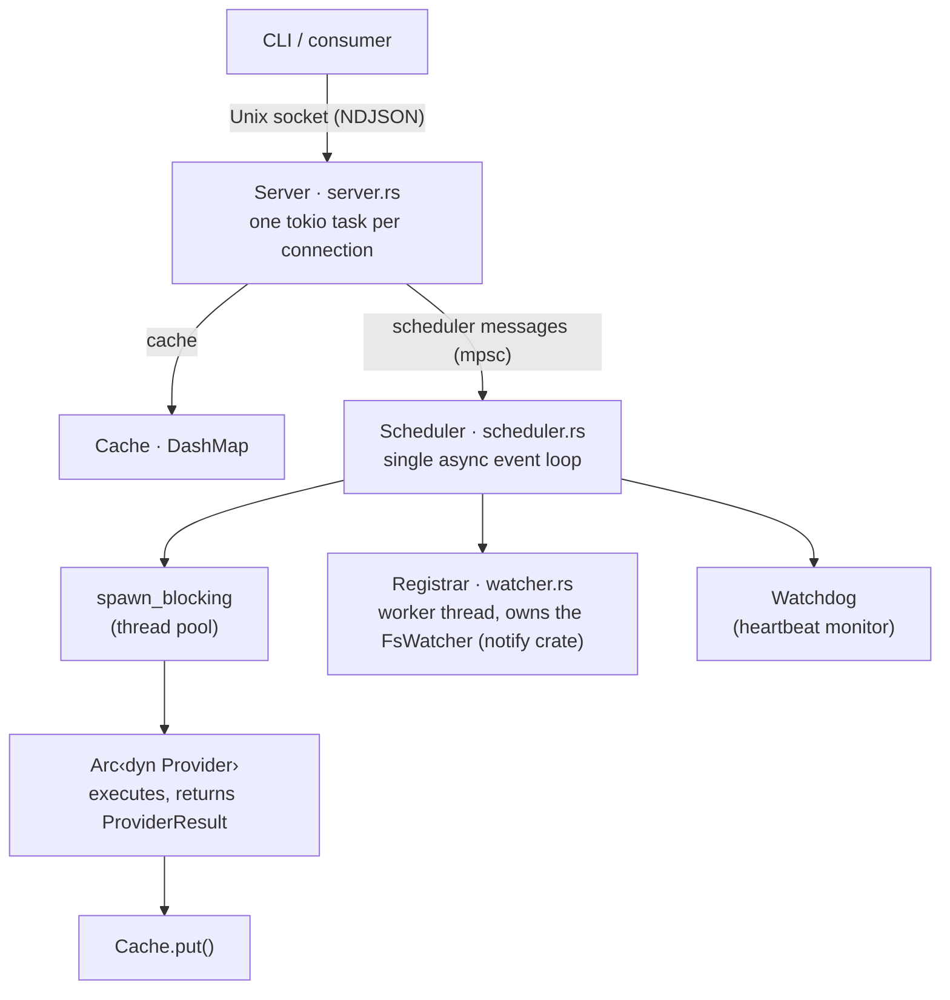
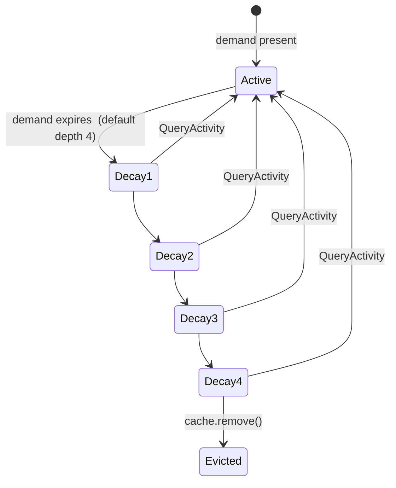

# beachcomber Architecture

Internal reference for contributors. Describes how the daemon (`comb daemon`) is structured, how components relate, and the reasoning behind key design choices.

---

## 1. System Overview



Data flow summary:

- **Read path**: client -> Server -> Cache.get() -> response (no provider involved)
- **Write path**: trigger (fs event or poll timer) -> Scheduler -> spawn_blocking(provider.execute()) -> Cache.put()
- **Miss path**: client asks for uncached key -> Server starts the instance's run (or takes the one in flight) -> the run executes on spawn_blocking and writes its result to cache -> the read, which waited for it, answers

The Server and Scheduler share `Arc<Cache>` and `Arc<ProviderRegistry>`. The Server sends messages to the Scheduler over an `mpsc::Sender<SchedulerMessage>`. The Scheduler owns all demand/poll state and the table that routes file events to instances; its `Registrar`'s worker thread owns the `FsWatcher` and makes every registration, so the loop never waits for one.

---

## 2. Module Map

| File | Responsibility |
|---|---|
| `src/lib.rs` | Module declarations; no logic |
| `src/daemon.rs` | Process lifecycle: fork, pid file, wait-for-socket, `run_daemon_with_cancel`; watchdog task monitors scheduler heartbeat |
| `src/server.rs` | Unix socket accept loop; one task per connection; request dispatch; response formatting |
| `src/scheduler/` | Single event loop: handles Refresh/QueryActivity/file events/poll tick; owns all demand and watch state; heartbeat counter for watchdog liveness detection |
| `src/scheduler/lifecycle.rs` | `LifecycleRegistry` — per-key cache lifecycle state machine: Active → Decay (1 to `decay` steps, default 4; the depth is data in `<p>:cache`) → Evicted. Exponential decay of poll interval and step duration each stage. See §5. |
| `src/cache.rs` | Lock-free DashMap store mapping `"provider\0path"` keys to `CacheEntry`; per-source `SourceResult` sub-entries within each `CacheEntry` |
| `src/run.rs` | `Runs`: one run per instance at a time, whoever starts it (a read, a poll, a file event, a refresh, `--force`, a Source's call). `start` hands back the run in flight, the one queued behind it, or a new one; the run executes on the blocking pool under its timeout and records itself in a task of its own; a caller waits on the `Run` it was handed. A reload overtakes runs in flight there |
| `src/watcher.rs` | `FsWatcher`, a thin wrapper around the `notify` crate, and the `Registrar` whose worker thread registers each watched path: Pending, then Active (on the path, or through the nearest directory above it that exists while it does not) or Failed (asked for again by the next demand) |
| `src/protocol.rs` | Re-exports `libbeachcomber::protocol`, the one definition of the wire: `Request`, `Response` and the `status`, `introspect` and `hello` payloads, which the daemon, the CLI, the C ABI and the SDKs share. Key parsing into a `KeyParse` lives in `src/query.rs` (`parse_key`) |
| `src/query.rs` | Source-aware request planning: `parse_key` (`provider` / `provider.field` — a source name is never a key segment), `resolve_path`, `validate_key` (one colon form, the facet), `split_layer_facet` (`:put` / `:source` / `:cache`, and the closed facet set of `libbeachcomber::key::split_facet`), and `QueryPlan::build` which derives the `SourceDemand` (which Sources a query warms). Consumed by both `Get` and `Watch` |
| `src/config.rs` | TOML config loading from XDG directories; `Config` (composed from its layers), `DaemonConfig` |
| `src/provider/mod.rs` | The `Source` trait (`ConfigSource` its one implementation in production); `ProviderMetadata`, `SourceMetadata`, `FieldSchema`, `InvalidationStrategy`, `FailbackConfig`; `expand_abs_path()` helper |
| `src/provider/registry.rs` | `ProviderRegistry`: the Sources a configuration declares, and their providers' metadata; `declared_sources` map (`HashMap<(provider, field), source_name>`) walked by `sources_for_key` (nearest declared ancestor of a key, then sentinel fields); built-in registration; validation at registration |
| `src/watcher_registry.rs` | Broadcast channel registry for watch subscribers; subscription keyed per `(provider, path, source)` with support for both relative `patterns` and absolute `abs_paths` |
| `src/plugin/` | The plugins compiled in: `StaticLibrary` over a table of `extern "C"` symbols, answered by name before any search path, each call through the one path a library's takes. `sys/` for what only the OS can say, `git/` for what a repository says through git's commands (the symbols `refs`, `diff`, `lineage`, `status`; `src/boundaries/git.rs` is the one place git's environment is set) |
| `src/provider/config_source.rs` | `ConfigSource`: a Source whose `root`, `data` and `result` are jinja lines on the daemon's engine (`exec`, `url`, `plugin`); built from `[daemon.providers.<p>.sources.<s>]` by `src/shape/build.rs` |
| `src/client.rs` | `Client` (one-shot) and `ClientSession` (persistent) for consumer-side socket communication |

Every provider is a shipped file. `git` is `defaults/git.toml`: five config Sources, `head` reading `<gitdir>/HEAD` itself and the others calling the compiled-in `git` plugin (`src/plugin/git/`). `hostname`, `user`, `uname`, `load`, `uptime`, `battery` and `network` are shipped files, `defaults/<name>.toml`, each one config Source whose `data` line calls the compiled-in `sys` plugin (`src/plugin/sys/`); so is `mise`, whose `data` line runs `mise ls --current --json`. `aws_profiles` and `gcloud_configs` are **data providers** whose cached fields are indexed by the templates in the managed `defaults/aws.toml` and `defaults/gcloud.toml`, which the client renders as the `aws` and `gcloud` namespaces (see `docs/canon/field_resolution.md`). `conda`, `op`, `kubecontext` and `talos` are not providers at all: their fields are templates in `defaults/`, the last two rendered by calling `kubectl`/`talosctl` through `exec()`.

Shipped files: `terraform`, `python`, `direnv`, `asdf`, `aws_profiles`, `gcloud_configs` and `sudo` have no Rust behind them either. Their Sources are config Sources in `defaults/terraform.toml`, `defaults/python.toml`, `defaults/direnv.toml`, `defaults/asdf.toml`, `defaults/aws.toml`, `defaults/gcloud.toml` and `defaults/sudo.toml` that read the files themselves; the daemon writes the files and composes them as its lowest layer, so a user overrides any line of them as of a Source of their own.

### Provider→Source layering

The Provider/Source/Field model has three layers:

- **Provider** — a named namespace (e.g., `git`). Declares 1+ Sources. The cache key `provider\0path` is still at this level.
- **Source** — one invalidation strategy, one set of fields, one lifecycle entry. Key for lifecycle, watches, and failure backoff is `(provider, path, source)`. Examples: git's `head`, `refs`, `diff`, `lineage`, `status` sources.
- **Field** — a typed value. Belongs to exactly one Source within a Provider.

The registry maps a key to its Source by walking the key: the Source of the nearest ancestor node that declares one wins, so `mise.node.version` finds the Source that declares `node`, and a Source that cannot list its field names declares a sentinel (`<tool>`) that answers for the provider node itself.

**Lifecycle keying** uses `(provider, path, source)` — each source instance has its own Active/Decay/Evicted state, independent of sibling sources at the same `(provider, path)`.

**Cache layout** — `CacheEntry.sources: HashMap<source_name, SourceResult>`. Each `SourceResult` holds `fields`, `last_refreshed_ms`, and `expected_interval_secs`. Reads flatten across sources; writes are per-source (`cache.put_source(provider, path, source_name, result)`).

**Watch registration** — per `(provider, path, source)`. Each source declares relative `patterns` (matched within the instance's root) and/or absolute `abs_paths` (e.g., `$XDG_CONFIG_HOME/mise`). The `expand_abs_path()` helper expands `~`, `$HOME`, and XDG env vars at registration time. The scheduler subscribes the instance to each path and asks the `Registrar` for a path once, on its first subscriber; the registrar's worker makes the registration (FSEvents can take seconds on a loaded host) while the loop goes on. Until it is made the path is Pending and its events are not seen. A path that does not exist is watched through the entries of the nearest directory above it that does, and moved onto the path once an event there shows it exists; a registration that fails is asked for again by the next demand, and `comb check daemon` warns of it.

### Provider execution

Sources implement `Source::execute(dir) -> Result<SourceResult, String>`. The scheduler calls
each source independently via `tokio::task::spawn_blocking`. Source results are
written to `CacheEntry.sources[source_name]`; sibling sources in the same
cache entry are untouched.

A Source has one *instance* per root. `Source::root(dir)` names the instance that
answers for a directory — `Some(root)`, or `None` for the one instance at `~` — and
a Source that does not override it has only the instance at `~`. Each instance is
its own lifecycle key and cache sub-entry, `(provider, root, source)`.

A read walks a Source's instances: the nearest first (`root(dir)`), then, if the key
is missing there, the parent of that root (`root(parent(root))`), ending at the
instance at `~`. `asdf` is one Source (`tools`) this way: inside a project
`asdf.node` is the project's `.tool-versions`, and `asdf.go`, set only in
`~/.tool-versions`, is found at `~`. A namespace read merges every instance on the way, the nearer winning.
That is a *cascade*, the default. A `nearest` Source (git, direnv, python,
terraform) is answered by the instance `root(dir)` finds alone: a missing key is
absent, the walk does not move up, and finding no root means no instance, with no
fallback to `~`.

Cache keys use `provider\0root` for a rooted instance and bare `provider` for the
instance at `~`. A single provider can own both kinds of entries simultaneously.

### Config shape and reload

Configuration has two roots. `[daemon]` holds settings and `providers`; `[client]`
holds `providers.<p>.template`. A provider exists if either root names it. The
shape layer (`src/shape/`) builds providers from the composed files
(`defaults/*.toml`, `config.toml`, `conf.d/*.toml`): a config Source is a jinja
function (`root`, `data`, `result`, `return`) whose `_` prototypes and `| super`
chains are resolved at load, its decorators (`poll`, `watch`, `ttl`, `failback`,
`budget`, `nearest`) become the Source's `InvalidationStrategy` and failback, and
a provider's own `template`/`result`/`return` lines are checked at load too (they
do no IO).
`enabled = false` makes the registry treat the provider as having no Sources.

A Source's lines may call other Sources (`sources.<s>()`,
`daemon.providers.<p>.sources.<s>()`). Calls are found at load, so an unknown
callee or a ring is a load error. At run time a call answers with the callee's
stored record, and a callee with nothing stored runs once for the read or
refresh that needs it, the caller's run waiting for it on its blocking thread
(a wait that would close a ring of runs waiting on one another reads the last
stored value instead); the scheduler demands what a Source's last run called, so
callees stay warm and decay with their callers. Decay depth is data: the
`<p>:cache._.decay` prototype is read when a lifecycle registers.

The config self-watch classifies each change. An edit confined to
`[daemon.providers]` or `[client.providers]` reloads in place: the new providers
are built once, the facet reseed is planned, and only if both succeed are they
swapped in and the scheduler's lifecycle entries brought to match (Sources whose
body changed or that are gone are evicted; Sources whose schedule changed are
retuned in place; the rest are untouched). A change to a bare `[daemon]` or
`[client]` key restarts the daemon.

---

## 3. Request Lifecycle: `comb get git.branch .`

This traces the full path from CLI invocation to output on stdout.

**Step 1: CLI entry point**

The `comb get` subcommand resolves the socket path (`--socket` → `[daemon] socket_path` → `$BEACHCOMBER_SOCKET` → `/tmp/beachcomber-<uid>/sock`, `libbeachcomber::socket::resolve`). If no daemon serves it, `cli::connect` checks the configuration — a configuration the daemon would refuse is reported before anything is spawned — then `libbeachcomber::spawn::ensure` starts `comb daemon --socket <path>` as a detached child, its stderr appended to the daemon's log, and waits up to ~1.6s for the socket to appear. Every SDK spawns through the same function.

**Step 2: Socket connection**

The client opens a Unix stream to the socket. For a one-shot `comb get`, this is a fresh connection. For `ClientSession` consumers (prompts, status bars), the connection is reused.

**Step 3: Request serialisation**

The CLI constructs:
```json
{"op":"get","key":"git.branch","path":"."}
```
and writes it as a single newline-terminated line.

**Step 4: Server receives the request**

`Server::run()` has accepted the connection and spawned `handle_connection()` as a tokio task. The task reads lines from a `BufReader`, deserialises into `Request::Get { key: "git.branch", path: Some(".") }`.

**Step 5: Key splitting**

`protocol::split_key("git.branch")` returns `("git", Some("branch"))`. The provider name is `"git"`, the field name is `"branch"`.

**Step 6: Path resolution**

`QueryPlan::build` canonicalises the explicit path `"."` (if the CLI had omitted the path argument, the session's context path would be used instead). Which instance of each demanded Source answers for it is found next, by `Source::root`, nearest first (see "Provider execution").

**Step 7: Cache lookup**

`cache.record_state("git", Some(root), "head")` looks up the instance's record (the key `"git\0<root>"` in the DashMap) and checks it: within its lifetime, and its stat inputs as its run stamped them (`Source::inputs`, for `head` the repository's `HEAD`; for a config Source its `watch(...)` declaration and the files its lines read). One `stat(2)` per input, on the request task. A valid record is answered as it is; nothing runs.

**Step 8: Field extraction**

The handler accesses `entry.result.get("branch")` and converts the `Value::String` to a `serde_json::Value`. It packages this into `Response::ok(data, age_ms, stale)`.

**Step 9: Response formatting**

The server always emits the JSON envelope (`Response::ok(data, age_ms, stale)`) over the wire. Rendering into other shapes — plain text, `sh`, csv/tsv, fmt — happens client-side (e.g. in the `comb` CLI), not on the server.

**Step 10: CLI prints and exits**

The client reads the response line, strips metadata, and writes the plain text to stdout.

**On a cache miss:**

The server finds no record for the instance and starts its run (`Runs::start`), or takes the run already in flight, whoever started it. The run executes on `tokio::task::spawn_blocking` and writes its result to the cache itself; the read waits for it and answers from what it wrote, in the same response. The client receives data on the first query — there is no empty response or polling step. A read that stops waiting (its connection gone) takes nothing with it: the run records itself.

**On a record whose inputs changed, or past its lifetime:**

A record whose stat inputs changed since its run (a `git checkout` rewrote `HEAD`) is invalid; one older than its Source's poll interval is `stale`. Either way the read runs the Source and waits up to the Source's budget (`budget(...)`, else `[daemon] budget`, default `50ms`), counted from when the read began; a read's own `wait` (`--wait 0`, `--wait 2s`, `--wait forever`) replaces the budget, and replaces a cold read's or a forced one's wait for its run's end too. A stale record takes the run in flight; an invalid one takes it only if that run's own inputs are as they are now (it stamped them after the change, or has yet to), else the run queued behind it. In time, the read answers the fresh value; late, it answers the stored one (`stale` if it is past its lifetime) while `:cache.<field>.executing` says the run goes on, and the run records itself for the next read and for any `watch`. A namespace read starts every run it needs before it waits for any, so its Sources run together.

So a read after a change answers the new value whether or not the file event has arrived: correctness does not wait for the watcher, which keeps the background warming. A run stamps its declared inputs immediately before it executes, so a change during the run fails the next check: one run more, never a stale answer.

A record's inputs are the files its Source declares and the files its run's lines read. A config Source's lines note each file they read in the run's account (`run::reads_here`, the `EngineCtx`'s `touched`), stamped immediately before it is read: `read`, `stat` and `realpath` the path, `lup` every path its walk probed (a marker made nearer is a change, so misses count as hits do), `glob` each directory it listed, as a node, and each literal component it found missing or ended on. The run's record is checked for its declared inputs and then those, a path both declared and read keeping its declared stamp. A run reads at most 64 files that count (`MOST_TOUCHED` in `libbeachcomber::fs`): past that, a file is not checked and the daemon logs once per Source (`<p>.<s>: 150 files read; the first 64 are checked on read`). A read that finds an input changed takes the run in flight only if that run's declared stamps, and the stamps of what its lines have read so far, are as the files are now. A `root` line's walk is not a run's input: the root a directory finds is kept by the registry.

What an `exec` child reads, or a change deeper than a checked directory, stays eventual, brought up to date by the watch and the poll. A read of `:cache`, `:put` or `:source`, a `watch` frame, `status` and `refresh` check nothing.

---

## 4. Provider Execution Lifecycle: Filesystem Event -> Cache Write

This traces what happens when the user saves a file in a git repository being watched.

**Step 1: OS delivers an inotify/kqueue event**

The `notify` crate's `RecommendedWatcher` receives the event on a background thread. It calls the closure registered in `FsWatcher::new()`, which drops a read (inotify reports every open; a close after writing is kept) and calls `tx.blocking_send(event.paths)` on the mpsc channel for anything else.

**Step 2: Scheduler receives the event**

The scheduler's `tokio::select!` loop picks up `Some(paths) = fs_rx.recv()`. A path watched through a directory above it is looked for again first (`Registrar::look_again`), then the changed paths are routed.

**Step 3: Path matching**

`resolve_keys_from_paths` iterates over the changed paths. For each changed path, it scans `watch_paths` (a `HashMap<PathBuf, Vec<Subscription>>`, each subscription a lifecycle key and the patterns an event below the path must match) looking for any registered watch path that is a prefix of (or equal to) the changed path. A pattern with a `/` matches by whole components, so `.git/index` matches `.git/index` and `.git/refs` matches `.git/refs/heads/main`; `.git/index.lock` matches neither.

**Step 4: the run is started**

An Active entry takes the event (`LifecycleRegistry::on_fsevent`; a decaying one has no watch, and a late event does nothing). A Source instance waits for its files to go quiet, 30 ms after the last change and at most 500 ms after the first (`Settling`): one command makes a burst of changes, and a run during the burst reads a state about to go and shares the budget of the read that follows. Then `Scheduler::fire` does what the key's event means. For a Source instance, `self.execute_source("git", "refs", Some("/home/user/myrepo"), Want::Fresh)` asks the run table for a run of that instance that begins after the event (`Runs::start`): a file event may follow a change the run in flight has already read past. For a memo (below), it drops the memo's hash.

A Source whose `watch` has a `.` covers the tree below its root. An event there runs nothing and resets no decay: it moves a count the record's run noted before it began (`TreeEvents`), so `Validity::check` says the record is invalid and the next read runs the Source. Until the root's registration has been made, and from entering decay until the next demand makes it again, no record is valid: nothing would say what changed.

A read of such a Source first passes `Barrier` (`src/watcher.rs`), so the event is in before it looks. It touches a sentinel file in a directory of the daemon's, watched like any other path, and waits for that event at the scheduler's own loop, at most 20 ms: a watcher delivers in order, so what came before has been through that loop. On macOS, 17 more touches take the kernel past the 16 pending events at which it wakes `fseventsd` at once, about 0.9 ms where its timer takes about 11; were that ever to change a read would take the 11 ms and still be right. Readers that arrive during a barrier share the next, and a whole read of `git` passes one. Under the polling fallback there is none.

**Step 5: One run per instance**

If a run of the instance is in flight, whoever started it (a read, a poll, a refresh), a fresh request queues one run behind it, and every fresh request until it starts shares that one: at most one run in flight per instance, and one queued. A poll or a cold read takes the run in flight instead.

**Step 6: Failure backoff check**

Before a new run starts, `Runs::start` checks the failure state. If the Source has exceeded its failure threshold (default 3) and is within its exponential backoff window (starting at the failback interval, default `1s`, doubling for 4 levels), no run starts; only `--force` runs past it. A config Source sets both on its `return` line (`| failback(interval, count)`; the shipped abstract Source has `failback('1s', 3)`). A built-in Source has its own, until `[daemon.providers.<p>.sources.<s>] return` names them: a `return` on a built-in replaces its failback with the line's, or with the engine's `failback('1s', 3)` where the line is silent. Only the Source's metadata is read; no config table is consulted when scheduling.

**Step 7: spawn_blocking**

The run executes in a task of its own:
```rust
runtime.spawn(async move {
    let result = tokio::time::timeout(
        timeout,
        tokio::task::spawn_blocking(move || {
            let _here = Here::enter(run, reads.clone()); // the run's account, on its thread
            let declared = Stamped::take(source.inputs(&invalidation, root));
            let result = source.execute(dir);             // the lines stamp what they read into `reads`
            (result, Validity::of(declared.and_read(reads.touches())))
        }),
    ).await;
    settle.finish(result);
});
```

The stamp of the declared inputs is taken on the blocking thread immediately before `execute`, each file the lines read is stamped as they read it, and the validity of both is stored with the record.

`spawn_blocking` runs `Source::execute()` on tokio's dedicated blocking thread pool, so the scheduler's loop and the request tasks go on while it runs. Nobody waits on the task: the scheduler goes on at once, and a read waits on the `Run` it was handed.

**Step 8: Source executes**

`GitRefs::execute(Some("/home/user/myrepo"))` runs `git status --porcelain=v2 --branch` in a subprocess and reads `.git/logs/refs/stash` directly. It returns a `SourceResult`.

**Step 9: Cache write**

Back in the run's task, under the run table's lock (the one a reload overtakes runs under): on success, `cache.put_source("git", Some("/home/user/myrepo"), "refs", fields, schedule)`. It replaces only that Source's record at the entry, leaving sibling Sources untouched, and writes the `Schedule` (poll interval, decay) into the `git:cache` entry beside it. A failure writes nothing, so the last good value stands, and counts toward the failback.

**Step 10: What follows**

The run's waiters have its outcome, and the run queued behind it, if any, starts; otherwise the instance's slot goes.

**A memo's file event**

A memo (a template leaf's value that `| cache()` stored, §5) watches the absolute paths its write-back named, and its subscription routes an event to the memo's own lifecycle key: `source` `memo:` (shown as `memo`), `node` the leaf. Nothing runs: `fire` calls `Cache::drop_memo_hash`, which drops the memo's `hash` from `<p>:cache.<leaf>` at the memo's directory and notifies the namespace there, so a watcher of the leaf re-renders, misses, and writes the memo afresh. The event is no demand: the memo's window is the one its write began.

---

## 5. Demand-Driven Cache Lifecycle

**Demand signal**

Every `get` request sends `SchedulerMessage::QueryActivity { provider, instances }` to the scheduler, one `(source, root)` for every instance the read reached. This records the current time in the `demand` HashMap for each. If an instance is new to demand, the scheduler immediately sets up polling (based on provider metadata) and filesystem watching (relative `watch` paths under the instance's root; none for the relative paths of the instance at `~`), and starts the instance's run if it has nothing stored (a read that found it cold has one in flight, which it takes).

**Demand window**

The scheduler's per-second tick checks all demand entries. Any key not queried within the last 120 seconds is considered expired. When demand expires for a key:

- The poll timer for that key is removed.
- Filesystem watches for that key are removed (if no other keys share the watch path).
- The key enters the decay lifecycle managed by `LifecycleRegistry` (`src/scheduler/lifecycle.rs`).

**Cache lifecycle (decay sequence)**

When a key loses demand it enters an exponential-backoff decay tracked by `LifecycleRegistry`:



Each decay step doubles the poll interval and the step duration relative to the previous step. The number of steps is the entry's `decay`, which is data (default 4; see `<p>:cache._.decay`), and the diagram shows the default. At `Evicted`, `cache.remove()` is called. If `QueryActivity` arrives for a key during any decay stage, the key is reinstated to `Active` immediately. An instance watches its files only while it is `Active`: entering `Decay1` drops its watches, so an idle daemon holds none, and a file event never reinstates a key. The read that reinstates it registers its watches again; until then a read checks the record's files by stat (§4), so a decaying record is never answered past a change to them.

**Static addresses: puts and memos**

A put with a `ttl` and every memo are lifecycle entries of their own, keyed by their address (`Key.node`), and no read demands them: their write starts the entry afresh (`PutWritten`, `MemoWritten`, each replacing the entries the write displaced) and nothing else renews it. A `ttl` is `poll(ttl, 1)` with decay 1: the poll is the expiry clock (for a put nothing runs; for a memo its hash is dropped) and the entry is evicted one doubled step later, a put's address or a memo's value and record (`Cache::evict_put`, `Cache::evict_memo`). A memo's `watch` paths register through the `Registrar` when it is written and, as every entry's watches, exist only while it is Active: they go when it decays. A write-back that names a path the memo already watches keeps its registration. A memo with no `ttl` is watch-only: Active for the default window (12 minutes), then down its provider's `_.decay` ladder and evicted, about six hours after its write at the default depth. A decayed memo whose file has changed since is the client's to catch: it folds the files' stamps into the memo's hash, so the stored hash no longer matches. A reload leaves both alone; a memo takes a new `_.decay` with its next write.

**Idle shutdown**

When `cache.is_empty()` and `demand.is_empty()` both hold true and no activity has been seen for `[daemon] idle_shutdown`, the daemon exits.

---

## 6. Concurrency Model

**Tokio runtime**

The daemon runs on a multi-threaded tokio runtime. The Server spawns one task per connection (lightweight, async I/O only). The Scheduler runs as a single async task with a `tokio::select!` loop.

**spawn_blocking for providers**

All provider `execute()` calls happen in `tokio::task::spawn_blocking`. This moves them to a dedicated thread pool (separate from the async worker threads), ensuring that a slow provider (git, battery, network) cannot starve the scheduler loop or connection handlers. The thread pool size is managed by tokio and scales with available cores.

**DashMap for cache**

`Cache` wraps a `DashMap<String, CacheEntry>`. DashMap provides fine-grained shard locking, allowing concurrent reads and writes without a global mutex. Cache reads — the hot path hit on every client request — are effectively lock-free under contention.

**Arc<dyn Provider> for registry**

Providers are stored as `Arc<dyn Provider>`. When the scheduler needs to execute a provider, it calls `registry.get(name)` which returns `Arc::clone()`. The cloned Arc is moved into `spawn_blocking`. The registry itself is never mutated after startup; reads from multiple tasks are contention-free.

**Scheduler-owned mutable state**

The Scheduler owns its coordination state: the lifecycle entries (demand, poll and decay timers) and the table that routes file events. This state is only accessed from the single scheduler task, so it requires no synchronisation. The run table (`src/run.rs`) and the failure state are shared, behind a `Mutex`, by the scheduler, the request tasks and the runs' own tasks, and every registry of the daemon holds the same ones.

**No provider-side concurrency**

Providers are `Send + Sync` but stateless. They hold no mutable state. The same `Arc<dyn Provider>` can be passed to multiple concurrent `spawn_blocking` calls for different paths without coordination.

---

## 7. Key Design Decisions

**Single-string cache keys (`"provider\0path"`)**

Early versions used a `(String, Option<String>)` tuple as the DashMap key, requiring two heap allocations per lookup. Changing to a single string with a null-byte separator (`"git\0/home/user/repo"`) reduced this to one allocation and improved cache read latency by 16% (183ns to 157ns). The null byte is safe as a separator because it cannot appear in valid filesystem paths. See `docs/performance.md` §1.2.

**spawn_blocking, not async providers**

The `Source` trait's `execute` method is synchronous (`fn execute(&self, path: Option<&str>) -> Vec<(Option<String>, ProviderResult)>`). This is intentional. Providers need to call blocking APIs: `std::process::Command`, `std::fs::read_to_string`, `libc` syscalls. Async providers would require those calls to be wrapped in `spawn_blocking` internally anyway. Keeping the interface synchronous is simpler, and `spawn_blocking` at the callsite (the scheduler) is the right place to manage the thread pool boundary. This also means provider authors don't need to think about async.

**One run per instance, whoever starts it**

A run records itself, in a task of its own, so whoever started it need not wait: the scheduler never does, which keeps its loop responsive at all times, and a read waits only as long as it chooses, taking nothing with it when it stops. Consumers learn about fresh values on their next `get` request, not via push.

Naively, a burst of filesystem events (e.g., a `git commit` touching many `.git` files), or a read and a poll at once, would launch many concurrent runs of one instance. The run table allows at most one run in flight per instance and queues at most one more behind it. At most two runs ever answer a burst: the one in flight when it began, and one that starts after it. This bounds both resource usage and cache write rate.

A Source's run that reads another (`comb.<p>`, `sources.<s>()`) waits for that one's run from its blocking thread. The run table knows which runs wait on which, so a wait that would close a ring of runs waiting on one another is refused and the caller reads the last stored value: a Source never waits on itself. When the daemon stops, a run's task that is dropped unfinished still ends its run, so nothing waits on it for ever.

**Two independent backoff mechanisms**

Failure backoff (in `FailureState`, exponential 1s-60s, per key) suppresses execution when a provider fails repeatedly. Cache lifecycle decay (in `LifecycleRegistry`, Active → Decay → Evicted) handles resource cleanup when a key drops out of the demand window. They serve different purposes and are deliberately kept separate.

**Watch connections are long-lived**

A `watch` request takes over the connection for the duration of the stream. The server task does not return to the request dispatch loop; instead it loops, blocking on the broadcast receiver, and emits an NDJSON line to the client on each cache update for the watched key. The connection terminates when the client disconnects or the daemon shuts down.

**Field-level deduplication for watch**

Watching `git.branch` only emits a line when the branch value itself changes, not on every git provider update. The watch handler records the last emitted value and skips writes when the new value is identical. This prevents spurious output when unrelated git fields (e.g., `ahead`, `dirty`) change.

**Broadcast channels for watch subscribers**

`src/watcher_registry.rs` maintains a `tokio::sync::broadcast` channel per (provider, path) key. `Cache::put()` notifies the registry after every write. Watch connections subscribe to the relevant channel. Using broadcast rather than mpsc allows multiple simultaneous watchers on the same key without coordination between them.

**Static records via put**

External processes can write arbitrary data into the cache via the `put` protocol op. A namespace no code or config registers is entirely static — a `CacheEntry` holding only `put`/`config:<file>` records, with no associated `Arc<dyn Provider>` — and such records are never polled. A `put --ttl` is the exception: it is a lifecycle entry of its own, one per put address, valid for the ttl, stale for one decay step, then evicted. There is no ownership: a `put` can write into any namespace and over any record, and every supplier keeps a layer of its own in the same cache entry. A read stacks them at each directory (source, then `config:` seeds, then `put`, with a template above all of them); a `put` replaces the node it addresses, and removing it (`put <node> null`) shows the layer below at once.
