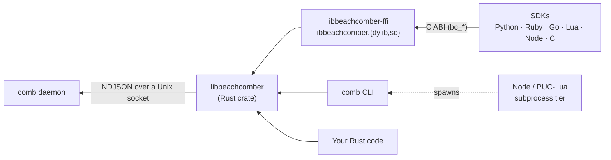

# How the Libraries Work

Every beachcomber client, from `comb` itself to a Ruby script, answers from one Rust library, `libbeachcomber`. The
language SDKs do not speak the socket protocol themselves: they load a C build of that library and call into it. This
page explains the layers, so you can pick a library knowing what it costs and debug one knowing where to look.



- **The daemon** holds the cache and runs providers. It never renders a template.
- **`libbeachcomber`** is the client half: it finds the socket, talks to the daemon, and renders templates.
- **`libbeachcomber-ffi`** wraps that crate in a C ABI and builds it as a shared library, `libbeachcomber.dylib` on
  macOS and `libbeachcomber.so` elsewhere.
- **The SDKs** bind that shared library from their language. The C SDK is the ABI itself.

Because every surface goes through the same code, a key is worth the same thing everywhere: Python's `get("git")`
answers what `comb get git` prints in the same directory.

## libbeachcomber: the client

`libbeachcomber` is a synchronous Rust crate (no tokio). It does four jobs.

### Finding the socket

The socket is chosen in this order, and the first that applies wins:

1. `comb --socket <path>` (the CLI only).
2. `[daemon] socket_path` in `config.toml` (the CLI and daemon only; the library never reads config).
3. `$BEACHCOMBER_SOCKET`, when set and not empty.
4. `/tmp/beachcomber-<uid>/sock`.

`$TMPDIR` and `$XDG_RUNTIME_DIR` are never consulted: there is one daemon per user, not per login session. An SDK
client takes steps 3 and 4 unless you give it a `socket_path`.

If no daemon answers an auto-discovered socket and `autostart` is on (the default), the library starts one: it runs
the first executable `comb` on `$PATH`, exactly as the CLI does, and waits until it serves. A client given an explicit
`socket_path` never starts a daemon; it reports `daemon_not_running` or `connection_failed` instead.

### Rendering: the resolver

The daemon stores templates as data (at `<provider>:template`) and never evaluates them, because a template needs the
caller's environment and working directory. Rendering is the client's job, and `libbeachcomber::resolve` is the one
function that does it. `comb get`, `comb eval`, the C ABI's `bc_get` and `bc_eval`, and so every SDK's `get` and
`eval`, all call it. There is no second implementation that could drift.

A read fetches what it needs from the daemon (cached values, templates, memos), renders any templated leaves against
the caller's environment, and returns the plain value. A miss is null, not an error. See
[Templates](../concepts/templates.md) for the template language and [The Tree](../concepts/values-and-names.md) for what a key
addresses.

### Clients and sessions

- A **client** opens a fresh connection for each call. Default timeouts: 250 ms for any one read or write, and
  connecting retries for up to 1500 ms.
- A **session** holds one connection open for many calls, and can remember a working directory (`set_context`) that
  every later `get`, `put` and `refresh` uses when it names none.

### Watches

A watch follows the *value* of a key, not one cache record. The library subscribes to every key the resolution read,
re-renders when any of them changes, and emits only when the rendered value is different. Editing a template under a
watch fires it too. A watch has its own connection (a watching connection streams and can do nothing else), so there
is no watch on a session.

## libbeachcomber-ffi: the C ABI

The FFI crate holds no logic of its own; each function delegates to `libbeachcomber`. Its header is
[`libbeachcomber-ffi/include/beachcomber.h`](https://github.com/NavistAu/beachcomber/blob/main/libbeachcomber-ffi/include/beachcomber.h),
generated by cbindgen, and the [C SDK page](./c-sdk.md) lists every function.

### What it exports

| Group | Functions |
|---|---|
| Library | `bc_version`, `bc_socket_path`, `bc_string_free` |
| Client | `bc_client_new`, `bc_client_free`, `bc_get`, `bc_eval`, `bc_put`, `bc_refresh`, `bc_status`, `bc_hello`, `bc_introspect` |
| Session | `bc_session_open`, `bc_session_close`, `bc_session_set_context`, `bc_session_get`, `bc_session_put`, `bc_session_refresh` |
| Watch | `bc_watch_open`, `bc_watch_next`, `bc_watch_cancel`, `bc_watch_free` |

Three opaque handles, `BcClient`, `BcSession` and `BcWatch`, carry state between calls. A watch keeps its client alive,
so you may free them in any order.

### JSON in, JSON out

Arguments that are more than a string are JSON text: client options, a `put`'s data, a caller's environment, `get`'s
`force`/`wait` options. Every operation returns one NUL-terminated JSON envelope in one of two shapes:

```json
{"ok": true,  "data": <the result>}
{"ok": false, "error": {"kind": "<kind>", "message": "<text>"}}
```

These are real envelopes from a client made with `bc_client_new(NULL)`:

```text
bc_hello            {"data":{"daemon_version":"0.9.1+sha.e22096aa","protocol_version":"1.0"},"ok":true}
bc_get hostname.short   {"data":"myhost","ok":true}
bc_get nosuch.thing     {"data":null,"ok":true}
bc_eval "{{ exec('echo hi') }}"
                    {"error":{"kind":"server_error","message":"<eval>: expression eval error: exec() is disabled in this context"},"ok":false}
```

A miss is `"data": null` inside an `ok` envelope. `bc_watch_next` adds an `outcome` field so a binding can tell its
results apart without matching strings: `event` (with `data`), `timeout`, `eof` or `cancelled`. A failure is the
ordinary `ok: false` envelope.

Constructors never fail on bad input. `bc_client_new`, `bc_session_open` and `bc_watch_open` always return a handle
(NULL only when the process is out of memory or file descriptors), and a problem such as malformed options is reported
on the handle's first operation:

```text
bc_client_new('{"timeout":5}')  then bc_get:
{"error":{"kind":"parse_error","message":"malformed options_json: unknown field `timeout`, expected one of `socket_path`, `timeout_ms`, `connect_timeout_ms`, `autostart`, `exec` at line 1 column 10"},"ok":false}
```

Unknown option keys are refused, so each option has one spelling. The defaults live in `bc_client_new` alone; an SDK
passes on what its caller gave and adds no defaults of its own.

### Ownership

- Every `char *` a `bc_*` function returns belongs to the caller: free it with `bc_string_free`.
- The exception is `bc_version()`, which returns a static string. Never free it.
- Free handles with `bc_client_free`, `bc_session_close` and `bc_watch_free`. All three, and `bc_string_free`, accept
  NULL.
- A freed handle must not be used again. The SDKs guard this themselves: after `close`, a call fails with `io_error`
  before the library is reached.

### Threads

- A client call opens its own connection, so client calls do not contend for one.
- A session or watch is one connection behind an internal lock. A second caller that finds it in use gets
  `kind: "busy"` at once, rather than blocking or interleaving its request with another.
- `bc_watch_cancel` is the one call documented as safe from another thread while an operation is in flight. It ends
  a pending `bc_watch_next` at once, which returns `cancelled`.
- A Rust panic never unwinds into the caller: each entry point catches it and returns a `panic` envelope.

### Error kinds

| Kind | Comes from | Means |
|---|---|---|
| `daemon_not_running` | library | No daemon answers, and none was started. |
| `connection_failed` | library | The socket could not be connected to. |
| `io_error` | library | A read or write on the socket failed. |
| `parse_error` | library | A request, response, option or template could not be read. |
| `server_error` | library | The daemon refused the request, or a template failed to render. |
| `timeout` | library | A read or write ran out `timeout_ms`. |
| `busy` | ABI | A session or watch is in use by another caller. |
| `panic` | ABI | The library panicked; caught at the boundary. |
| `library_not_found` | SDK | No `libbeachcomber` loaded from any candidate. |
| `library_symbol` | SDK | The library that loaded lacks a function the SDK calls. |
| `unsupported` | SDK | A subprocess tier cannot do this operation. |

Each SDK has one error type per kind, carrying `kind`, the library's `message` unchanged, and `library_version` (the
loaded library's `bc_version()`).

## How each SDK binds it

| SDK | Binding | Extra dependency | Finds the library by |
|---|---|---|---|
| [Rust](./rust-sdk.md) | links the crate directly; no C ABI | none | Cargo |
| [Python](./python-sdk.md) | `ctypes` | none (stdlib) | discovery rule |
| [Ruby](./ruby-sdk.md) | `fiddle` | none (stdlib) | discovery rule |
| [Go](./go-sdk.md) | `purego` (no cgo) | `purego`, vendored | discovery rule |
| [Lua](./lua-sdk.md) | LuaJIT `ffi` | none | discovery rule |
| [Node.js](./nodejs-sdk.md) | `koffi` | `koffi`, optional peer | discovery rule |
| [C](./c-sdk.md) | the header and `-lbeachcomber` | none | the platform linker and run-path |

### The discovery rule

Every SDK except Rust and C looks for the library at run time, trying in order:

1. `$BEACHCOMBER_LIB`, when set and not empty. It is then the only candidate: a path you set on purpose that does not
   load is an error, not a reason to try another.
2. Beside `comb`: `<dir>/../lib/libbeachcomber.{dylib,so}`, where `<dir>` holds the first executable `comb` on
   `$PATH`, symlinks resolved. A Homebrew `comb` is a symlink into the Cellar, and the library sits beside it there.
3. The system loader, given the bare file name.

When nothing loads, the SDK raises `library_not_found`, naming each candidate it tried and why it failed. When the
library loads but lacks a function the SDK needs (an SDK newer than its library, say), it raises `library_symbol`.
The rule is checked by one shared fixture,
[`sdks/discovery.json`](https://github.com/NavistAu/beachcomber/blob/main/sdks/discovery.json), that each SDK's tests
run. Lua also takes `library_path` in `connect`'s options, which acts as `$BEACHCOMBER_LIB`.

To debug a load failure, read the `library_not_found` message for the candidate list, then set `$BEACHCOMBER_LIB` to
the library you mean.

## Subprocess tiers

Two runtimes cannot always load a shared library: PUC Lua has no `ffi` module, and Node needs `koffi`, which is an
optional peer dependency. For these, the SDK has a second transport that runs `comb` once per call
(`comb get -f json`, `comb eval -f json`, `comb watch -f json`, and so on). Since `comb` links `libbeachcomber`
itself, the values are the same; what changes is cost and coverage.

The fallback is chosen only when the binding is absent by design: PUC Lua, or Node without `koffi` installed. A LuaJIT
or a Node with `koffi` that cannot find the library fails with `library_not_found`; it does not quietly fall back.
`client.transport()` reports which transport is active.

| | Node without `koffi` | PUC Lua |
|---|---|---|
| Cost | one `comb` process per call | one `comb` process per call |
| `hello`, `introspect` | `unsupported` | `unsupported` |
| `watch` | yes, one long-lived `comb watch` | `unsupported` (`io.popen` has no timed read or cancel) |
| `timeout_ms` | bounds each spawned `comb` (killed past it) | refused at connect (`unsupported`) |
| `connect_timeout_ms` | refused at construction (`unsupported`) | refused at connect (`unsupported`) |
| Session | emulated: remembers its directory and passes it as `--path` | emulated, the same way |
| `eval` errors | a template that does not compile is `server_error`, not `parse_error` | as Node |
| `library_version` on errors | `subprocess:<path to comb>` | `nil` |
| No `comb` on `$PATH` | `library_not_found` | `library_not_found` |

A call's `env` map becomes the spawned `comb`'s whole environment, `--socket` carries `socket_path` or
`$BEACHCOMBER_SOCKET`, and `--no-exec` is passed unless the client allows `exec`, so a spawned render matches an FFI
one.

## `exec()` is off on a client

A template can call `exec()` to run a command. `comb` allows it; a library client does not unless you ask, so a
program that embeds an SDK never spawns processes on the user's behalf by accident. Pass `exec: true` when you create
the client (`bc_client_new("{\"exec\":true}")`, `Client(exec=True)`, `WithExec(true)`, and so on). Without it, a
template that calls `exec()` fails with `exec() is disabled in this context`, as the envelope above shows. The option
applies to everything the client renders: `get`, `eval`, sessions and watches.

## Versions

The daemon, `comb`, `libbeachcomber` and every SDK are released together under one version number. Use matching
versions: an SDK calls the functions its own release's library exports, and a library that lacks one is reported as
`library_symbol`.

The library also compares itself with the daemon. On a client's first connection it asks the daemon's version
(`hello`) after the caller's own request, so the check costs nothing per call. The comparison is of the full build identity, commit included, so two
builds of the same release can differ. A mismatch is not an error: an older
daemon still running mid-upgrade is normal. Instead, every daemon error on that client names both versions:

```json
{"ok":false,"error":{"kind":"server_error","message":"nothing to refresh: nosuch has no sources (client is 0.9.1+sha.c25b96f9, daemon is 0.9.1+sha.e22096aa)"}}
```

If you see that suffix, restart the daemon (`comb kill`; the next client starts the new one). `hello()` returns
`daemon_version` and `protocol_version` if you want to check for yourself.
